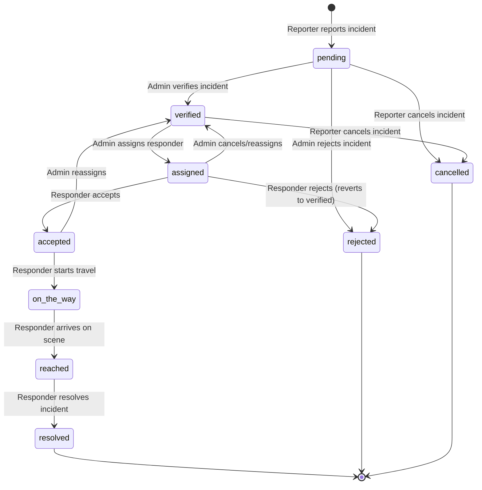

# SafeRoute Backend — Complete API Reference

> **Documentation Date:** 2026-10-21  
> **API Version:** `v1` (Mounted at `/api/v1`)  
> **Project Name:** SafeRoute Emergency Response & Incident Reporting Platform (`saferoute-backend`)  
> **Primary Source of Truth:** Source code residing in `d:/SafeRouteBackend`  
> **Companion Document:** [PROJECT_DOCUMENTATION.md](./PROJECT_DOCUMENTATION.md)

---

## Table of Contents

1. [Document Overview](#1-document-overview)
2. [API Overview](#2-api-overview)
3. [Base URL and Environment Configuration](#3-base-url-and-environment-configuration)
4. [Common Conventions](#4-common-conventions)
   - [HTTP Methods](#http-methods)
   - [Request Headers](#request-headers)
   - [Authentication & Revocation](#authentication--revocation)
   - [Authorization & Roles](#authorization--roles)
   - [Request Validation](#request-validation)
   - [Response Formats](#response-formats)
   - [Error Handling](#error-handling)
   - [Pagination Conventions](#pagination-conventions)
   - [Filtering, Searching, and Sorting](#filtering-searching-and-sorting)
   - [Date and Time Formats](#date-and-time-formats)
   - [File Uploads and Streaming](#file-uploads-and-streaming)
5. [Complete Endpoint Index](#5-complete-endpoint-index)
6. [Detailed API Documentation](#6-detailed-api-documentation)
   - [Module 1: System & Health (`HLTH-01`)](#module-1-system--health)
   - [Module 2: Authentication & Password Recovery (`AUTH-01` to `AUTH-07`)](#module-2-authentication--password-recovery)
   - [Module 3: Incident Management (`INC-01` to `INC-11`)](#module-3-incident-management)
   - [Module 4: Responder Dispatch & Operations (`RESP-01` to `RESP-12`)](#module-4-responder-dispatch--operations)
   - [Module 5: Administration & Analytics (`ADM-01` to `ADM-18`)](#module-5-administration--analytics)
   - [Module 6: User Profile & Account Management (`USR-01` to `USR-07`)](#module-6-user-profile--account-management)
   - [Module 7: Notifications (`NOTIF-01` to `NOTIF-05`)](#module-7-notifications)
   - [Module 8: Secured File Streaming (`FILE-01`)](#module-8-secured-file-streaming)
7. [Authentication and Authorization Reference](#7-authentication-and-authorization-reference)
8. [Shared Schemas and Data Models](#8-shared-schemas-and-data-models)
9. [Common Error Reference](#9-common-error-reference)
10. [Endpoint Dependencies and End-to-End Workflows](#10-endpoint-dependencies-and-end-to-end-workflows)
11. [External Service Integrations](#11-external-service-integrations)
12. [API Testing Guide](#12-api-testing-guide)
13. [API Coverage and Verification Audit](#13-api-coverage-and-verification-audit)

---

## 1. Document Overview

This document provides an exhaustive, source-code-accurate reference for every single API endpoint implemented in the SafeRoute Emergency Response & Incident Reporting Platform backend.

- **Project Name:** SafeRoute Emergency Response & Incident Reporting Platform (`saferoute-backend`)
- **Package Version:** `1.0.0`
- **Application Entry Point:** [`src/server.js`](file:///d:/SafeRouteBackend/src/server.js) / [`src/app.js`](file:///d:/SafeRouteBackend/src/app.js)
- **API Base Prefix:** `/api/v1`
- **Source Code Scope Analysed:** 100% of routes, controllers, services, repositories, Sequelize models, middlewares, constants, validators, and utilities.
- **Implementation Status:** 62 reachable API endpoints discovered and documented. 0 unmounted endpoints. 1 unused validator schema identified.
- **Dependencies & Prerequisites:** Node.js (v18+ / v20+ / v24+), MySQL (InnoDB dialect), valid SMTP credentials for email delivery, and local disk write access for the `uploads/` and `logs/` directories.

---

## 2. API Overview

SafeRoute is a mission-critical emergency incident reporting and responder dispatch platform. It bridges citizens (reporters), on-ground emergency units (ambulance, police, fire responders), and administrative dispatchers.

### Core Capabilities
1. **Public Incident Reporting:** Citizen reporting with GPS coordinates, categorization, severity rating, and multi-image attachments.
2. **Incident Verification & Dispatch:** Admin triage, verification, automated status transitions, and single-responder assignment.
3. **Emergency Unit Operations:** Real-time assignment acceptance, GPS location tracking, dispatch status progression (`assigned` &rarr; `accepted` &rarr; `on_the_way` &rarr; `reached` &rarr; `resolved`).
4. **Secured Media Storage:** Strict MIME and magic-byte header validation for image uploads, stored locally and served exclusively to authorized parties with path-traversal prevention.
5. **Auditing & History:** Full status history tracking capturing who altered an incident's status and when.
6. **Authentication & Token Rotation:** Dual-token JWT architecture (short-lived access tokens, database-persisted refresh tokens with SHA-256 hashing and rotation, instant token revocation upon user profile update).

### Communication Style
- **RESTful JSON:** Standard HTTP requests accepting `application/json` payloads and returning standardized JSON bodies.
- **Multipart Uploads:** `multipart/form-data` for file submissions (incident photos and profile avatars).
- **Binary Streaming:** Authenticated file retrieval delivering JPG, PNG, and WebP binaries with `X-Content-Type-Options: nosniff`.

---

## 3. Base URL and Environment Configuration

The API is mounted under the `/api/v1` prefix. An additional top-level rate limiter protects all routes matching `/api/*`.

| Environment | Host Origin | API Base Path | Complete Base URL | Configuration Source |
|---|---|---|---|---|
| **Local Development** | `http://localhost:5000` | `/api/v1` | `http://localhost:5000/api/v1` | `.env` (`PORT=5000`) |
| **Testing Environment** | `http://localhost:5000` | `/api/v1` | `http://localhost:5000/api/v1` | `process.env.PORT` |
| **Production** | Deployment domain | `/api/v1` | `https://<api-domain>/api/v1` | Reverse proxy / Cloud host |

### Rate Limiting Rules
1. **Global API Limiter:** Applied at `/api/*` in [`src/app.js`](file:///d:/SafeRouteBackend/src/app.js#L23-L28). Configurable via `RATE_LIMIT_WINDOW_MS` (default `900000` = 15 minutes) and `RATE_LIMIT_MAX` (default `1000` requests per IP). Returns HTTP 429 `{ success: false, message: 'Too many requests, please try again later.' }` when exceeded.
2. **Sensitive Auth Limiter:** Applied to authentication endpoints (`/register`, `/login`, `/forgot-password`, `/reset-password`) in [`src/routes/auth.routes.js`](file:///d:/SafeRouteBackend/src/routes/auth.routes.js#L15). Configurable via `AUTH_RATE_LIMIT_MAX` (default `10` failed attempts per 15 minutes per IP). Uses `skipSuccessfulRequests: true` so valid logins do not exhaust the quota.

---

## 4. Common Conventions

### HTTP Methods
- `GET`: Read resources, lists, analytics, dashboards, and stream files. Idempotent and safe.
- `POST`: Create entities (incidents, responders, sessions, files) or trigger non-idempotent workflows (logout, password resets).
- `PUT`: Complete resource updates (incident updates, user profile updates).
- `PATCH`: Partial state mutations (incident status transitions, assignment actions, notification read status).
- `DELETE`: Resource deletion (incident deletion, notification deletion, profile picture removal, assignment cancellation).

### Request Headers
| Header | Required | Format / Value | Description |
|---|---|---|---|
| `Content-Type` | Conditional | `application/json` | Required for all `POST`, `PUT`, `PATCH` requests carrying JSON payloads. |
| `Content-Type` | Conditional | `multipart/form-data` | Required for image upload endpoints (`/incidents/:id/images`, `/users/profile/image`). |
| `Authorization` | Conditional | `Bearer <ACCESS_TOKEN>` | Required for all protected routes. Contains the signed JWT access token. |

### Authentication & Revocation
- **Access Token:** Stateless JWT containing `{ id, email, role }`, signed with `JWT_SECRET`, default expiry `15m`.
- **Immediate Revocation Mechanism:** In [`src/middlewares/auth.middleware.js`](file:///d:/SafeRouteBackend/src/middlewares/auth.middleware.js#L25-L27), the server compares the token's issued-at timestamp (`decoded.iat * 1000`) against the user's `updated_at` database timestamp. If `user.updated_at > decoded.iat * 1000`, the access token is rejected immediately as revoked with HTTP 401.
- **Refresh Token:** Long-lived JWT signed with `JWT_REFRESH_SECRET`, default expiry `7d`. Persisted in the MySQL `refresh_tokens` table in SHA-256 hashed form (`hashToken(token)`). Rotated on each refresh.

### Authorization & Roles
Role enforcement is handled via [`src/middlewares/role.middleware.js`](file:///d:/SafeRouteBackend/src/middlewares/role.middleware.js) using the `authorize(...roles)` helper.
Three roles exist in [`src/constants/roles.js`](file:///d:/SafeRouteBackend/src/constants/roles.js):
- `reporter`: Default citizen role. Can report incidents, upload incident images, list own reports, update/cancel pending reports, and manage own account.
- `responder`: Emergency service personnel. Can view assigned incidents, accept/reject assignments, update response progress, update GPS coordinates, and view dispatch history.
- `admin`: Platform operator. Can access dashboards, analytics, reports, triage/verify/reject incidents, assign/reassign responders, manage user accounts, and view all system data.

### Request Validation
Implemented via Zod (`zod ^3.23.8`) using [`src/middlewares/validation.middleware.js`](file:///d:/SafeRouteBackend/src/middlewares/validation.middleware.js).
- Schemas strictly validate request bodies, query strings (`validate(schema, 'query')`), or path parameters (`validate(schema, 'params')`).
- If validation fails, the middleware aborts the request and responds with HTTP 422:
```json
{
  "success": false,
  "message": "Validation failed",
  "errors": [
    {
      "field": "email",
      "message": "Invalid email"
    }
  ],
  "errorCode": "VALIDATION_001"
}
```

### Response Formats
All API responses follow a uniform JSON envelope produced by [`src/utils/response.js`](file:///d:/SafeRouteBackend/src/utils/response.js).

#### Standard Success Response
```json
{
  "success": true,
  "message": "Operation description",
  "data": {},
  "meta": {}
}
```
*(Note: `data` and `meta` are omitted when null).*

#### Standard Error Response
```json
{
  "success": false,
  "message": "Error description",
  "errors": [],
  "errorCode": "ERROR_CODE_STRING"
}
```
*(Note: `errors` and `errorCode` are omitted when null).*

### Error Handling
The centralized error handling middleware [`src/middlewares/error.middleware.js`](file:///d:/SafeRouteBackend/src/middlewares/error.middleware.js) intercepts all exceptions:
- **Operational Errors (`AppError`):** Returns custom status code, message, and application error code.
- **Multer Errors:**
  - `LIMIT_FILE_SIZE` &rarr; HTTP 400 (`File size exceeds the limit`)
  - `LIMIT_FILE_COUNT` &rarr; HTTP 400 (`Too many files`)
  - `LIMIT_UNEXPECTED_FILE` &rarr; HTTP 400 (`Unexpected file field`)
  - Custom file filter mismatch &rarr; HTTP 400 (`Only JPG, PNG, and WEBP images are allowed`)
- **Sequelize Errors:**
  - `SequelizeValidationError` &rarr; HTTP 400 with field-level details.
  - `SequelizeUniqueConstraintError` &rarr; HTTP 409 (`Duplicate entry`).
- **Uncaught Errors:** In development, returns the actual error message. In production, masks message with `Internal Server Error` and returns HTTP 500 while logging the stack trace via Winston.

### Pagination Conventions
Pagination utilities in [`src/utils/pagination.js`](file:///d:/SafeRouteBackend/src/utils/pagination.js) standardize offset-based pagination:
- **Query Parameters:** `page` (positive integer, default: 1), `size` (positive integer, default: 10, max: 100).
- **Metadata Envelope:**
```json
"pagination": {
  "totalItems": 45,
  "totalPages": 5,
  "currentPage": 1,
  "itemsPerPage": 10
}
```

### Filtering, Searching, and Sorting
- **Filtering:** Available on incident and user endpoints by `status`, `incident_type`, `severity`, `role`, `is_active`, and `is_read`.
- **Searching:** Supported on incidents (searches `title`, `description`, and `address` via SQL `LIKE %search%`) and users (searches `full_name`, `email`, and `phone` via SQL `LIKE %search%`).
- **Sorting:** Incidents and users are ordered by `created_at DESC`. Status history is ordered by `created_at ASC`.

### Date and Time Formats
All dates accepted and returned by the API use ISO 8601 strings in UTC (e.g., `2026-10-21T14:22:10.000Z`).

### File Uploads and Streaming
- Stored on disk under `uploads/` (configured by `UPLOAD_DIR`).
- Upload filenames are generated as UUIDv4 with true extension (e.g., `3f7b2c01-8e99-4d92-bb8a-6b2169b1e95e.jpg`).
- **Magic Byte Validation:** [`src/utils/upload.js`](file:///d:/SafeRouteBackend/src/utils/upload.js#L9-L15) inspects the initial byte headers of uploaded files to ensure they are authentic JPEG (`FF D8 FF`), PNG (`89 50 4E 47 0D 0A 1A 0A`), or WebP (`RIFF...WEBP`) binaries, preventing file extension spoofing attacks.
- **Secured Retrieval:** [`src/controllers/file.controller.js`](file:///d:/SafeRouteBackend/src/controllers/file.controller.js) enforces regex validation on filenames to prevent path traversal and validates whether the requesting user owns or is authorized to view the image.

---

## 5. Complete Endpoint Index

The table below lists all 62 reachable endpoints implemented in the application.

| # | ID | Method | Endpoint Path | Module | Authentication | Authorization | Implementation Status |
|---|---|---|---|---|---|---|---|
| 1 | `HLTH-01` | GET | `/api/v1/health` | System | Public | None | Implemented |
| 2 | `AUTH-01` | POST | `/api/v1/auth/register` | Authentication | Public | None (Rate Limited) | Implemented |
| 3 | `AUTH-02` | POST | `/api/v1/auth/login` | Authentication | Public | None (Rate Limited) | Implemented |
| 4 | `AUTH-03` | POST | `/api/v1/auth/refresh-token` | Authentication | Public | None | Implemented |
| 5 | `AUTH-04` | POST | `/api/v1/auth/logout` | Authentication | Public | None | Implemented |
| 6 | `AUTH-05` | POST | `/api/v1/auth/forgot-password` | Authentication | Public | None (Rate Limited) | Implemented |
| 7 | `AUTH-06` | POST | `/api/v1/auth/reset-password` | Authentication | Public | None (Rate Limited) | Implemented |
| 8 | `AUTH-07` | POST | `/api/v1/auth/change-password` | Authentication | Required | Any authenticated user | Implemented |
| 9 | `INC-01` | POST | `/api/v1/incidents` | Incidents | Required | `reporter` | Implemented |
| 10 | `INC-02` | POST | `/api/v1/incidents/:id/images` | Incidents | Required | `reporter` (Owner) | Implemented |
| 11 | `INC-03` | GET | `/api/v1/incidents/my` | Incidents | Required | `reporter` | Implemented |
| 12 | `INC-04` | PATCH | `/api/v1/incidents/:id/cancel` | Incidents | Required | `reporter` (Owner) | Implemented |
| 13 | `INC-05` | PUT | `/api/v1/incidents/:id` | Incidents | Required | `reporter` (Owner) | Implemented |
| 14 | `INC-06` | DELETE | `/api/v1/incidents/:id` | Incidents | Required | `reporter` (Owner) | Implemented |
| 15 | `INC-07` | GET | `/api/v1/incidents/search` | Incidents | Required | `admin` | Implemented |
| 16 | `INC-08` | GET | `/api/v1/incidents/nearby` | Incidents | Required | `admin` | Implemented |
| 17 | `INC-09` | GET | `/api/v1/incidents/:id` | Incidents | Required | Admin, Owner Reporter, or Assigned Responder | Implemented |
| 18 | `INC-10` | GET | `/api/v1/incidents/:id/status-history` | Incidents | Required | Admin, Owner Reporter, or Assigned Responder | Implemented |
| 19 | `INC-11` | GET | `/api/v1/incidents/:id/responder-location` | Incidents | Required | `reporter` (Owner), `admin` | Implemented |
| 20 | `RESP-01` | GET | `/api/v1/responders/dashboard` | Responder | Required | `responder` | Implemented |
| 21 | `RESP-02` | GET | `/api/v1/responders/incidents` | Responder | Required | `responder` | Implemented |
| 22 | `RESP-03` | GET | `/api/v1/responders/incidents/completed` | Responder | Required | `responder` | Implemented |
| 23 | `RESP-04` | GET | `/api/v1/responders/incidents/:id` | Responder | Required | `responder` (Assignment Owner) | Implemented |
| 24 | `RESP-05` | PATCH | `/api/v1/responders/incidents/:id/accept` | Responder | Required | `responder` (Assignment Owner) | Implemented |
| 25 | `RESP-06` | PATCH | `/api/v1/responders/incidents/:id/reject` | Responder | Required | `responder` (Assignment Owner) | Implemented |
| 26 | `RESP-07` | PATCH | `/api/v1/responders/incidents/:id/start-travel` | Responder | Required | `responder` (Assignment Owner) | Implemented |
| 27 | `RESP-08` | PATCH | `/api/v1/responders/incidents/:id/arrived` | Responder | Required | `responder` (Assignment Owner) | Implemented |
| 28 | `RESP-09` | PATCH | `/api/v1/responders/incidents/:id/resolve` | Responder | Required | `responder` (Assignment Owner) | Implemented |
| 29 | `RESP-10` | POST | `/api/v1/responders/location` | Responder | Required | `responder` | Implemented |
| 30 | `RESP-11` | GET | `/api/v1/responders/notifications` | Responder | Required | `responder` | Implemented |
| 31 | `RESP-12` | PATCH | `/api/v1/responders/notifications/:notificationId/read` | Responder | Required | `responder` | Implemented |
| 32 | `ADM-01` | GET | `/api/v1/admin/dashboard` | Admin | Required | `admin` | Implemented |
| 33 | `ADM-02` | GET | `/api/v1/admin/analytics` | Admin | Required | `admin` | Implemented |
| 34 | `ADM-03` | GET | `/api/v1/admin/reports/monthly` | Admin | Required | `admin` | Implemented |
| 35 | `ADM-04` | GET | `/api/v1/admin/incidents` | Admin | Required | `admin` | Implemented |
| 36 | `ADM-05` | GET | `/api/v1/admin/incidents/:id` | Admin | Required | `admin` | Implemented |
| 37 | `ADM-06` | PATCH | `/api/v1/admin/incidents/:id/verify` | Admin | Required | `admin` | Implemented |
| 38 | `ADM-07` | PATCH | `/api/v1/admin/incidents/:id/reject` | Admin | Required | `admin` | Implemented |
| 39 | `ADM-08` | POST | `/api/v1/admin/incidents/:id/assign` | Admin | Required | `admin` | Implemented |
| 40 | `ADM-09` | POST | `/api/v1/admin/incidents/:id/reassign` | Admin | Required | `admin` | Implemented |
| 41 | `ADM-10` | DELETE | `/api/v1/admin/assignments/:id` | Admin | Required | `admin` | Implemented |
| 42 | `ADM-11` | GET | `/api/v1/admin/responders/available` | Admin | Required | `admin` | Implemented |
| 43 | `ADM-12` | POST | `/api/v1/admin/responders` | Admin | Required | `admin` | Implemented |
| 44 | `ADM-13` | GET | `/api/v1/admin/users` | Admin | Required | `admin` | Implemented |
| 45 | `ADM-14` | GET | `/api/v1/admin/users/:id` | Admin | Required | `admin` | Implemented |
| 46 | `ADM-15` | PUT | `/api/v1/admin/users/:id` | Admin | Required | `admin` | Implemented |
| 47 | `ADM-16` | PATCH | `/api/v1/admin/users/:id/disable` | Admin | Required | `admin` | Implemented |
| 48 | `ADM-17` | GET | `/api/v1/admin/notifications` | Admin | Required | `admin` | Implemented |
| 49 | `ADM-18` | PATCH | `/api/v1/admin/notifications/:notificationId/read` | Admin | Required | `admin` | Implemented |
| 50 | `USR-01` | GET | `/api/v1/users/profile` | Users | Required | Any authenticated user | Implemented |
| 51 | `USR-02` | PUT | `/api/v1/users/profile` | Users | Required | Any authenticated user | Implemented |
| 52 | `USR-03` | POST | `/api/v1/users/profile/image` | Users | Required | Any authenticated user | Implemented |
| 53 | `USR-04` | DELETE | `/api/v1/users/profile/image` | Users | Required | Any authenticated user | Implemented |
| 54 | `USR-05` | POST | `/api/v1/users/change-password` | Users | Required | Any authenticated user | Implemented |
| 55 | `USR-06` | DELETE | `/api/v1/users/account` | Users | Required | Any authenticated user | Implemented |
| 56 | `USR-07` | POST | `/api/v1/users/logout-all` | Users | Required | Any authenticated user | Implemented |
| 57 | `NOTIF-01` | GET | `/api/v1/notifications` | Notifications | Required | Any authenticated user | Implemented |
| 58 | `NOTIF-02` | GET | `/api/v1/notifications/:id` | Notifications | Required | Any authenticated user (Owner) | Implemented |
| 59 | `NOTIF-03` | PATCH | `/api/v1/notifications/:id/read` | Notifications | Required | Any authenticated user (Owner) | Implemented |
| 60 | `NOTIF-04` | PATCH | `/api/v1/notifications/read-all` | Notifications | Required | Any authenticated user | Implemented |
| 61 | `NOTIF-05` | DELETE | `/api/v1/notifications/:id` | Notifications | Required | Any authenticated user (Owner) | Implemented |
| 62 | `FILE-01` | GET | `/api/v1/files/:filename` | Files | Required | Authorized Image Viewer | Implemented |

---

## 6. Detailed API Documentation

### Module 1: System & Health

#### [HLTH-01] Health Check Endpoint

##### Overview
- **Method:** `GET`
- **Path:** `/api/v1/health`
- **Full URL:** `http://localhost:5000/api/v1/health`
- **Module:** System
- **Description:** Verifies that the HTTP service is operational and responsive.
- **Authentication:** Public (No token required).
- **Authorization:** Open to all clients.
- **Handler:** Inline callback in [`src/routes/index.js`](file:///d:/SafeRouteBackend/src/routes/index.js#L12-L14).
- **Source File:** `src/routes/index.js`
- **Implementation Status:** Implemented.

##### Purpose and Behaviour
Used by uptime monitors, container orchestrators, and reverse proxies to check service availability without hitting database bottlenecks.

##### Request Parameters
- **Path Parameters:** None.
- **Query Parameters:** None.
- **Request Headers:** None required.
- **Request Body:** None.

##### Example Request
```http
GET /api/v1/health HTTP/1.1
Host: localhost:5000
```
```bash
curl -X GET "http://localhost:5000/api/v1/health"
```

##### Successful Response
- **HTTP Status:** `200 OK`
- **Content-Type:** `application/json`
```json
{
  "success": true,
  "message": "SafeRoute API is running",
  "timestamp": "2026-10-21T14:35:00.123Z"
}
```

##### Error Responses
None during normal operation. May return `429 Too Many Requests` if the top-level IP rate limit is exceeded.

##### Business Logic & Side Effects
Generates a current ISO timestamp and returns immediately. No database queries, file access, or side effects.

---

### Module 2: Authentication & Password Recovery

#### [AUTH-01] Register New Citizen Reporter

##### Overview
- **Method:** `POST`
- **Path:** `/api/v1/auth/register`
- **Full URL:** `http://localhost:5000/api/v1/auth/register`
- **Module:** Authentication
- **Description:** Registers a new public citizen account with the `reporter` role.
- **Authentication:** Public.
- **Authorization:** Open (Protected by sensitive rate limiter: 10 req/15min).
- **Handler:** `authController.register` in [`src/controllers/auth.controller.js`](file:///d:/SafeRouteBackend/src/controllers/auth.controller.js#L5-L12).
- **Service:** `authService.register` in [`src/services/auth.service.js`](file:///d:/SafeRouteBackend/src/services/auth.service.js#L16-L40).
- **Validator:** `registerSchema` in [`src/validators/auth.validator.js`](file:///d:/SafeRouteBackend/src/validators/auth.validator.js#L3-L8).
- **Implementation Status:** Implemented.

##### Request Parameters
- **Path / Query Parameters:** None.
- **Request Headers:** `Content-Type: application/json`.
- **Request Body Schema (Strict Mode):**
| Field | Type | Required | Constraints | Description | Example |
|---|---|---|---|---|---|
| `full_name` | string | Yes | Min 2, max 100 characters | Full legal name of user | `"John Citizen"` |
| `email` | string | Yes | Valid email format | Unique contact and login email | `"john@example.com"` |
| `phone` | string | Yes | Min 10, max 20 characters | Unique emergency contact phone | `"9876543210"` |
| `password` | string | Yes | Min 12, max 128 characters | Account password | `"SuperSecretPassword123!"` |

##### Example Request
```http
POST /api/v1/auth/register HTTP/1.1
Host: localhost:5000
Content-Type: application/json

{
  "full_name": "John Citizen",
  "email": "john@example.com",
  "phone": "9876543210",
  "password": "SuperSecretPassword123!"
}
```
```bash
curl -X POST "http://localhost:5000/api/v1/auth/register" \
  -H "Content-Type: application/json" \
  -d '{
    "full_name": "John Citizen",
    "email": "john@example.com",
    "phone": "9876543210",
    "password": "SuperSecretPassword123!"
  }'
```

##### Successful Response
- **HTTP Status:** `201 Created`
- **Content-Type:** `application/json`
```json
{
  "success": true,
  "message": "User registered successfully",
  "data": {
    "user": {
      "id": 2,
      "full_name": "John Citizen",
      "email": "john@example.com",
      "phone": "9876543210",
      "role": "reporter",
      "responder_type": null,
      "profile_image": null,
      "is_active": true,
      "last_known_latitude": null,
      "last_known_longitude": null,
      "created_at": "2026-10-21T14:36:00.000Z",
      "updated_at": "2026-10-21T14:36:00.000Z"
    }
  }
}
```

##### Error Responses
| HTTP Status | Condition | Error Code | Response Example |
|---|---|---|---|
| `409 Conflict` | Duplicate email | `USER_002` | `{"success": false, "message": "Email already registered", "errorCode": "USER_002"}` |
| `409 Conflict` | Duplicate phone number | `USER_002` | `{"success": false, "message": "Phone number already registered", "errorCode": "USER_002"}` |
| `422 Unprocessable Entity` | Validation failure (weak password, extra fields) | `VALIDATION_001` | `{"success": false, "message": "Validation failed", "errors": [{"field": "password", "message": "String must contain at least 12 character(s)"}], "errorCode": "VALIDATION_001"}` |
| `429 Too Many Requests` | Exceeded 10 requests / 15 min | N/A | Rate limit message |

##### Business Logic & Database Interaction
1. Checks if `email` exists in `users` table via `userRepo.findByEmail`. Throws 409 if found.
2. Checks if `phone` exists in `users` table via `userRepo.findByPhone`. Throws 409 if found.
3. Hashes password using Bcrypt with 12 salt rounds (`SALT_ROUNDS = 12`).
4. Creates a new record in `users` with `role = 'reporter'` and `is_active = true`.
5. Omits password hash and returns the sanitized user profile.

---

#### [AUTH-02] User Login

##### Overview
- **Method:** `POST`
- **Path:** `/api/v1/auth/login`
- **Full URL:** `http://localhost:5000/api/v1/auth/login`
- **Module:** Authentication
- **Description:** Authenticates user credentials and issues an Access/Refresh token pair.
- **Authentication:** Public.
- **Authorization:** Open (Sensitive rate limiter: 10 req/15min).
- **Handler:** `authController.login` in [`src/controllers/auth.controller.js`](file:///d:/SafeRouteBackend/src/controllers/auth.controller.js#L14-L21).
- **Service:** `authService.login` in [`src/services/auth.service.js`](file:///d:/SafeRouteBackend/src/services/auth.service.js#L42-L75).
- **Validator:** `loginSchema` in [`src/validators/auth.validator.js`](file:///d:/SafeRouteBackend/src/validators/auth.validator.js#L10-L13).

##### Request Parameters
- **Request Body Schema (Strict Mode):**
| Field | Type | Required | Constraints | Description | Example |
|---|---|---|---|---|---|
| `email` | string | Yes | Valid email format | Registered user email | `"john@example.com"` |
| `password` | string | Yes | Min 1, max 128 characters | Account password | `"SuperSecretPassword123!"` |

##### Example Request
```http
POST /api/v1/auth/login HTTP/1.1
Host: localhost:5000
Content-Type: application/json

{
  "email": "john@example.com",
  "password": "SuperSecretPassword123!"
}
```
```bash
curl -X POST "http://localhost:5000/api/v1/auth/login" \
  -H "Content-Type: application/json" \
  -d '{"email":"john@example.com","password":"SuperSecretPassword123!"}'
```

##### Successful Response
- **HTTP Status:** `200 OK`
- **Content-Type:** `application/json`
```json
{
  "success": true,
  "message": "Login successful",
  "data": {
    "user": {
      "id": 2,
      "full_name": "John Citizen",
      "email": "john@example.com",
      "phone": "9876543210",
      "role": "reporter",
      "responder_type": null,
      "profile_image": null,
      "is_active": true,
      "last_known_latitude": null,
      "last_known_longitude": null,
      "created_at": "2026-10-21T14:36:00.000Z",
      "updated_at": "2026-10-21T14:36:00.000Z"
    },
    "accessToken": "eyJhbGciOiJIUzI1NiIsInR5cCI6IkpXVCJ9...",
    "refreshToken": "eyJhbGciOiJIUzI1NiIsInR5cCI6IkpXVCJ9..."
  }
}
```

##### Error Responses
| HTTP Status | Condition | Error Code | Response Example |
|---|---|---|---|
| `401 Unauthorized` | User does not exist or password mismatch | `AUTH_001` | `{"success": false, "message": "Invalid credentials", "errorCode": "AUTH_001"}` |
| `403 Forbidden` | Account deactivated (`is_active: false`) | N/A | `{"success": false, "message": "Account is deactivated"}` |
| `422 Unprocessable Entity` | Malformed email or missing password | `VALIDATION_001` | Validation error array |

##### Business Logic & Database Interaction
1. Queries `users` table by `email`.
2. Verifies account `is_active === true`.
3. Compares `password` with `user.password` hash via `bcrypt.compare`.
4. Creates JWT access token (15m expiry) and JWT refresh token (7d expiry) containing `{ id, email, role }`.
5. Hashes the raw refresh token with SHA-256 (`hashToken(refreshToken)`).
6. Persists `{ user_id, token: hashedToken, expires_at }` in the `refresh_tokens` table.
7. Returns user profile, access token, and plain refresh token.

---

#### [AUTH-03] Refresh Access Token

##### Overview
- **Method:** `POST`
- **Path:** `/api/v1/auth/refresh-token`
- **Full URL:** `http://localhost:5000/api/v1/auth/refresh-token`
- **Module:** Authentication
- **Description:** Rotates an existing refresh token and issues a new access token and refresh token.
- **Authentication:** Public (Requires valid refresh token in body).
- **Handler:** `authController.refreshToken` in [`src/controllers/auth.controller.js`](file:///d:/SafeRouteBackend/src/controllers/auth.controller.js#L23-L30).
- **Service:** `authService.refreshToken` in [`src/services/auth.service.js`](file:///d:/SafeRouteBackend/src/services/auth.service.js#L77-L121).
- **Validator:** `refreshTokenSchema` in [`src/validators/auth.validator.js`](file:///d:/SafeRouteBackend/src/validators/auth.validator.js#L15-L17).

##### Request Parameters
- **Request Body Schema (Strict Mode):**
| Field | Type | Required | Description | Example |
|---|---|---|---|---|
| `refreshToken` | string | Yes | Valid, unexpired refresh token string | `"eyJhbGciOiJIUzI1NiIsInR5cCI6..."` |

##### Successful Response
- **HTTP Status:** `200 OK`
```json
{
  "success": true,
  "message": "Tokens refreshed",
  "data": {
    "accessToken": "eyJhbGciOiJIUzI1Ni...",
    "refreshToken": "eyJhbGciOiJIUzI1Ni..."
  }
}
```

##### Error Responses
| HTTP Status | Condition | Error Code | Response Example |
|---|---|---|---|
| `400 Bad Request` | Missing refresh token string | N/A | `{"success": false, "message": "Refresh token is required"}` |
| `401 Unauthorized` | Hash not found in DB or signature invalid | `AUTH_002` | `{"success": false, "message": "Invalid refresh token", "errorCode": "AUTH_002"}` |
| `401 Unauthorized` | Token expired | `AUTH_002` | `{"success": false, "message": "Refresh token expired", "errorCode": "AUTH_002"}` |
| `404 Not Found` | Associated user deleted or deactivated | `USER_001` | `{"success": false, "message": "User not found", "errorCode": "USER_001"}` |

##### Business Logic & Security Features
- **Token Rotation:** The old refresh token's hash is immediately deleted from `refresh_tokens`.
- A brand new refresh token is signed, hashed, and stored in `refresh_tokens`, preventing replay attacks.

---

#### [AUTH-04] User Logout

##### Overview
- **Method:** `POST`
- **Path:** `/api/v1/auth/logout`
- **Module:** Authentication
- **Description:** Invalidates a single refresh token session.
- **Authentication:** Public.
- **Handler:** `authController.logout` in [`src/controllers/auth.controller.js`](file:///d:/SafeRouteBackend/src/controllers/auth.controller.js#L32-L39).
- **Service:** `authService.logout` in [`src/services/auth.service.js`](file:///d:/SafeRouteBackend/src/services/auth.service.js#L123-L127).

##### Request Body
| Field | Type | Required | Description |
|---|---|---|---|
| `refreshToken` | string | Optional | Refresh token to invalidate |

##### Successful Response
- **HTTP Status:** `200 OK`
```json
{
  "success": true,
  "message": "Logged out successfully"
}
```

##### Business Logic
Computes `hashToken(refreshToken)` and deletes the matching record from `refresh_tokens`. If no token is provided or not found, still returns 200 OK gracefully.

---

#### [AUTH-05] Request Password Reset (Forgot Password)

##### Overview
- **Method:** `POST`
- **Path:** `/api/v1/auth/forgot-password`
- **Module:** Authentication
- **Description:** Generates a secure single-use reset token and emails a reset link to the user.
- **Authentication:** Public (Sensitive rate limiter: 10 req/15min).
- **Handler:** `authController.forgotPassword` in [`src/controllers/auth.controller.js`](file:///d:/SafeRouteBackend/src/controllers/auth.controller.js#L41-L48).
- **Service:** `authService.forgotPassword` in [`src/services/auth.service.js`](file:///d:/SafeRouteBackend/src/services/auth.service.js#L129-L153).
- **Validator:** `forgotPasswordSchema` in [`src/validators/auth.validator.js`](file:///d:/SafeRouteBackend/src/validators/auth.validator.js#L19-L21).

##### Request Body
| Field | Type | Required | Constraints | Description |
|---|---|---|---|---|
| `email` | string | Yes | Email format | Account email |

##### Successful Response
- **HTTP Status:** `200 OK`
```json
{
  "success": true,
  "message": "If the email exists, a reset link has been sent."
}
```

##### Business Logic & Privacy Protection
- **No User Enumeration:** Always returns the same message regardless of whether the email exists in the database.
- If user exists:
  1. Generates 32 random bytes (`crypto.randomBytes(32).toString('hex')`).
  2. Computes SHA-256 hash of token.
  3. Purges all previous reset tokens for this user (`deleteAllByUserId`).
  4. Stores `{ user_id, token_hash, expires_at: 15 minutes }` in `password_reset_tokens`.
  5. Sends email via Nodemailer Gmail SMTP with URL `${FRONTEND_URL}/reset-password?token=${token}`.
  6. If email sending fails, deletes the token hash immediately.

---

#### [AUTH-06] Reset Password with Token

##### Overview
- **Method:** `POST`
- **Path:** `/api/v1/auth/reset-password`
- **Module:** Authentication
- **Description:** Resets user password using the token sent via email.
- **Authentication:** Public (Sensitive rate limiter: 10 req/15min).
- **Handler:** `authController.resetPassword` in [`src/controllers/auth.controller.js`](file:///d:/SafeRouteBackend/src/controllers/auth.controller.js#L50-L57).
- **Service:** `authService.resetPassword` in [`src/services/auth.service.js`](file:///d:/SafeRouteBackend/src/services/auth.service.js#L155-L175).
- **Validator:** `resetPasswordSchema` in [`src/validators/auth.validator.js`](file:///d:/SafeRouteBackend/src/validators/auth.validator.js#L23-L26).

##### Request Body
| Field | Type | Required | Constraints | Description |
|---|---|---|---|---|
| `token` | string | Yes | Min 1 char | Hex reset token received via link |
| `newPassword` | string | Yes | Min 12, max 128 chars | New account password |

##### Successful Response
- **HTTP Status:** `200 OK`
```json
{
  "success": true,
  "message": "Password reset successfully"
}
```

##### Error Responses
- `400 Bad Request` with `errorCode: "AUTH_002"` if token is missing, expired, or invalid.

##### Business Logic & Database Interaction
Uses an ACID transaction (`sequelize.transaction`) with a row lock (`lock: transaction.LOCK.UPDATE`) on `password_reset_tokens`:
1. Hashes token and searches `password_reset_tokens`.
2. Validates `expires_at > new Date()`.
3. Hashes `newPassword` (Bcrypt 12 rounds) and updates `users.password`.
4. Deletes all active sessions (`refresh_tokens.deleteAllByUserId`).
5. Deletes all reset tokens for that user (`password_reset_tokens.deleteAllByUserId`).

---

#### [AUTH-07] Change Password (Auth Module)

##### Overview
- **Method:** `POST`
- **Path:** `/api/v1/auth/change-password`
- **Module:** Authentication
- **Description:** Allows an authenticated user to update their password by confirming their current password.
- **Authentication:** Required (`Bearer <ACCESS_TOKEN>`).
- **Handler:** `authController.changePassword` in [`src/controllers/auth.controller.js`](file:///d:/SafeRouteBackend/src/controllers/auth.controller.js#L59-L69).
- **Service:** `authService.changePassword` in [`src/services/auth.service.js`](file:///d:/SafeRouteBackend/src/services/auth.service.js#L177-L197).
- **Validator:** `changePasswordSchema` in [`src/validators/auth.validator.js`](file:///d:/SafeRouteBackend/src/validators/auth.validator.js#L28-L31).

##### Request Body
| Field | Type | Required | Constraints | Description |
|---|---|---|---|---|
| `currentPassword` | string | Yes | Min 1 char | User's current password |
| `newPassword` | string | Yes | Min 12, max 128 chars | New password (12 char min) |

##### Successful Response
- **HTTP Status:** `200 OK`
```json
{
  "success": true,
  "message": "Password changed successfully"
}
```

##### Error Responses
| HTTP Status | Condition | Error Code |
|---|---|---|
| `400 Bad Request` | Current password does not match | `AUTH_001` |
| `401 Unauthorized` | Missing / invalid / revoked access token | N/A |
| `404 Not Found` | User not found | `USER_001` |

##### Business Logic
1. Loads user by `req.user.id` and verifies `currentPassword`.
2. Hashes `newPassword` and updates `users.password` (this automatically bumps `updated_at`, invalidating previous access tokens!).
3. Calls `refreshTokenRepo.deleteAllByUserId(userId)` to terminate all refresh token sessions.

---

### Module 3: Incident Management

#### [INC-01] Report an Incident

##### Overview
- **Method:** `POST`
- **Path:** `/api/v1/incidents`
- **Module:** Incidents
- **Description:** Creates a new emergency incident report with status `pending`.
- **Authentication:** Required (`Bearer <ACCESS_TOKEN>`).
- **Authorization:** `reporter` role only.
- **Handler:** `incidentController.createIncident` in [`src/controllers/incident.controller.js`](file:///d:/SafeRouteBackend/src/controllers/incident.controller.js#L5-L12).
- **Service:** `incidentService.createIncident` in [`src/services/incident.service.js`](file:///d:/SafeRouteBackend/src/services/incident.service.js#L13-L30).
- **Validator:** `createIncidentSchema` in [`src/validators/incident.validator.js`](file:///d:/SafeRouteBackend/src/validators/incident.validator.js#L4-L12).

##### Request Body Schema
| Field | Type | Required | Constraints | Description | Example |
|---|---|---|---|---|---|
| `title` | string | Yes | Min 5, max 200 chars | Brief summary of emergency | `"Building Fire on 5th Avenue"` |
| `description` | string | Yes | Min 10 chars | Comprehensive details | `"Smoke and flames visible from the 3rd floor."` |
| `incident_type` | enum | Yes | One of: `road_accident`, `fire`, `medical_emergency`, `flood`, `earthquake`, `crime`, `gas_leak`, `electrical_hazard`, `other` | Categorization | `"fire"` |
| `severity` | enum | No | One of: `low`, `medium`, `high`, `critical`. Default: `medium` | Severity level | `"high"` |
| `latitude` | number | Yes | Min -90, max 90 | GPS Latitude | `40.7128` |
| `longitude` | number | Yes | Min -180, max 180 | GPS Longitude | `-74.0060` |
| `address` | string | No | Max 500 chars | Human-readable address | `"123 Main St, New York, NY"` |

##### Successful Response
- **HTTP Status:** `201 Created`
```json
{
  "success": true,
  "message": "Incident created successfully",
  "data": {
    "incident": {
      "id": 10,
      "title": "Building Fire on 5th Avenue",
      "description": "Smoke and flames visible from the 3rd floor.",
      "incident_type": "fire",
      "severity": "high",
      "status": "pending",
      "latitude": 40.7128,
      "longitude": -74.006,
      "address": "123 Main St, New York, NY",
      "reporter_id": 2,
      "created_at": "2026-10-21T14:40:00.000Z",
      "updated_at": "2026-10-21T14:40:00.000Z",
      "reporter": {
        "id": 2,
        "full_name": "John Citizen",
        "email": "john@example.com",
        "phone": "9876543210"
      },
      "images": [],
      "assignments": []
    }
  }
}
```

##### Business Logic & Transactions
Executes inside a database transaction:
1. Inserts into `incidents` with `reporter_id = req.user.id` and `status = 'pending'`.
2. Inserts audit record into `incident_status_history` with `previous_status: null`, `new_status: 'pending'`, `changed_by: req.user.id`, `notes: 'Incident reported'`.
3. Returns populated incident object.

---

#### [INC-02] Upload Incident Images

##### Overview
- **Method:** `POST`
- **Path:** `/api/v1/incidents/:id/images`
- **Module:** Incidents
- **Description:** Uploads up to 5 image attachments for a previously created incident.
- **Authentication:** Required (`Bearer <ACCESS_TOKEN>`).
- **Authorization:** `reporter` role; user must be the original reporter of the incident.
- **Handler:** `incidentController.uploadImages` in [`src/controllers/incident.controller.js`](file:///d:/SafeRouteBackend/src/controllers/incident.controller.js#L14-L25).
- **Service:** `incidentService.uploadImages` in [`src/services/incident.service.js`](file:///d:/SafeRouteBackend/src/services/incident.service.js#L32-L60).
- **Middleware:** `validate(idParamsSchema, 'params')`, `authorize(ROLES.REPORTER)`, `uploadIncidentImages`.

##### Request Parameters
- **Path Parameters:**
  - `id`: Positive integer (Incident ID).
- **Headers:** `Content-Type: multipart/form-data`.
- **Multipart Form Fields:**
  - `images`: Array of image files (1 to 5 files, maximum 5 MB each, MIME types: JPEG, PNG, WebP).

##### Successful Response
- **HTTP Status:** `200 OK`
```json
{
  "success": true,
  "message": "Images uploaded successfully",
  "data": {
    "incident": {
      "id": 10,
      "images": [
        {
          "id": 1,
          "incident_id": 10,
          "image_url": "/api/v1/files/b498e722-192a-43cf-a0e2-9d33261a8ef1.jpg",
          "created_at": "2026-10-21T14:42:00.000Z"
        }
      ]
    }
  }
}
```

##### Security Checks
1. Verifies ownership: `incident.reporter_id === req.user.id`. Throws 403 `INCIDENT_003` if unauthorized.
2. Checks files exist. Throws 400 if empty.
3. Magic byte check via `validateImageFile`: If any file fails, all uploaded files are deleted from disk with `deleteFile()` and throws 400.
4. Bulk-creates `IncidentImage` records with URL `/api/v1/files/${file.filename}`.

---

#### [INC-03] Get Reporter's Own Incidents

##### Overview
- **Method:** `GET`
- **Path:** `/api/v1/incidents/my`
- **Module:** Incidents
- **Description:** Retrieves a paginated list of incidents submitted by the authenticated reporter.
- **Authentication:** Required.
- **Authorization:** `reporter` role only.
- **Query Parameters:**
| Parameter | Type | Required | Default | Validation / Constraints | Description |
|---|---|---|---|---|---|
| `page` | integer | No | 1 | Positive integer &le; 100000 | Page number |
| `size` | integer | No | 10 | Positive integer &le; 100 | Page size |
| `status` | string | No | null | Enum matching `INCIDENT_STATUS` | Filter by incident status |

##### Successful Response
- **HTTP Status:** `200 OK`
```json
{
  "success": true,
  "message": "Incidents retrieved",
  "data": [
    {
      "id": 10,
      "title": "Building Fire on 5th Avenue",
      "status": "pending",
      "incident_type": "fire",
      "severity": "high",
      "images": []
    }
  ],
  "meta": {
    "totalItems": 1,
    "totalPages": 1,
    "currentPage": 1,
    "itemsPerPage": 10
  }
}
```

---

#### [INC-04] Cancel Incident

##### Overview
- **Method:** `PATCH`
- **Path:** `/api/v1/incidents/:id/cancel`
- **Module:** Incidents
- **Description:** Allows a reporter to cancel an incident if it has not yet been assigned or dispatched.
- **Authentication:** Required.
- **Authorization:** `reporter` role; user must own the incident.
- **Path Parameters:** `id` (Incident ID).

##### Business Rules
- Only incidents with status `pending` or `verified` can be cancelled.
- If status is `assigned`, `accepted`, `on_the_way`, `reached`, `resolved`, or already `cancelled`, throws HTTP 400 with `errorCode: "INCIDENT_002"`.
- Records transition in `incident_status_history` with notes `'Incident cancelled by reporter'`.

##### Successful Response
- **HTTP Status:** `200 OK`
```json
{
  "success": true,
  "message": "Incident cancelled",
  "data": { "incident": { "id": 10, "status": "cancelled" } }
}
```

---

#### [INC-05] Update Incident Details

##### Overview
- **Method:** `PUT`
- **Path:** `/api/v1/incidents/:id`
- **Module:** Incidents
- **Description:** Updates details of an incident before it has been processed.
- **Authentication:** Required.
- **Authorization:** `reporter` role; user must own the incident.
- **Path Parameters:** `id` (Incident ID).
- **Request Body (all optional):** `title`, `description`, `incident_type`, `severity`, `latitude`, `longitude`, `address`.

##### Business Rules
- Can **only** be modified while in `pending` status. If already verified, assigned, or resolved, throws HTTP 400 `INCIDENT_002` (`Cannot update incident after it has been processed`).

---

#### [INC-06] Delete Incident

##### Overview
- **Method:** `DELETE`
- **Path:** `/api/v1/incidents/:id`
- **Module:** Incidents
- **Description:** Completely deletes an incident and removes all associated photos from disk.
- **Authentication:** Required.
- **Authorization:** `reporter` role; user must own the incident.
- **Path Parameters:** `id` (Incident ID).

##### Business Rules & Side Effects
- Allowed **only** while in `pending` status.
- Executes within a database transaction:
  1. Retrieves all `IncidentImage` records.
  2. Deletes `IncidentImage` records from DB.
  3. Deletes `IncidentStatusHistory` records from DB.
  4. Deletes `Incident` record from DB.
- Outside transaction, physically unlinks image files from the local disk via `deleteFile()`.

##### Successful Response
- **HTTP Status:** `200 OK`
```json
{
  "success": true,
  "message": "Incident deleted"
}
```

---

#### [INC-07] Search All Incidents (Admin)

##### Overview
- **Method:** `GET`
- **Path:** `/api/v1/incidents/search`
- **Module:** Incidents
- **Description:** Search and filter across all platform incidents. Restricted to administrators.
- **Authentication:** Required.
- **Authorization:** `admin` role only.
- **Query Parameters:** `page`, `size`, `status`, `incident_type`, `severity`, `search`.

---

#### [INC-08] Geospatial Nearby Incidents (Admin)

##### Overview
- **Method:** `GET`
- **Path:** `/api/v1/incidents/nearby`
- **Module:** Incidents
- **Description:** Calculates distances from a coordinate pair and finds active incidents within a given radius using the Haversine formula.
- **Authentication:** Required.
- **Authorization:** `admin` role only.
- **Query Parameters (Validated by `nearbyQuerySchema`):**
| Parameter | Type | Required | Constraints | Description | Default |
|---|---|---|---|---|---|
| `latitude` | number | Yes | Min -90, max 90 | Center Latitude | - |
| `longitude` | number | Yes | Min -180, max 180 | Center Longitude | - |
| `radius` | number | No | Positive &le; 100 km | Search radius in kilometers | 5 km |

##### Database Interaction
Executes a parameterized raw SQL query with the Haversine formula against the MySQL database:
```sql
SELECT *, (
  6371 * ACOS(
    COS(RADIANS(:lat)) * COS(RADIANS(latitude)) *
    COS(RADIANS(longitude) - RADIANS(:lng)) +
    SIN(RADIANS(:lat)) * SIN(RADIANS(latitude))
  )
) AS distance
FROM incidents
WHERE status NOT IN ('resolved', 'cancelled')
HAVING distance <= :radius
ORDER BY distance ASC
LIMIT :limit
```

##### Successful Response
- **HTTP Status:** `200 OK`
```json
{
  "success": true,
  "message": "Nearby incidents retrieved",
  "data": {
    "incidents": [
      {
        "id": 10,
        "title": "Building Fire on 5th Avenue",
        "latitude": "40.71280000",
        "longitude": "-74.00600000",
        "distance": 0.421
      }
    ]
  }
}
```

---

#### [INC-09] Get Incident Details

##### Overview
- **Method:** `GET`
- **Path:** `/api/v1/incidents/:id`
- **Module:** Incidents
- **Description:** Retrieves complete incident details, including reporter, photos, and assignments.
- **Authentication:** Required.
- **Authorization:** Evaluated in `canAccessIncident`:
  - `admin`: Can view any incident with full unredacted data.
  - `reporter`: Can view only if `incident.reporter_id === user.id`. Contact fields of responder are redacted.
  - `responder`: Can view only if assigned to the incident. Reporter contact fields (`email`, `phone`) and other responder assignments are redacted.
- **Path Parameters:** `id` (Incident ID).

##### Error Responses
- `403 Forbidden` (`INCIDENT_003`): If the requesting user does not have permission to view the incident.
- `404 Not Found` (`INCIDENT_001`): If incident does not exist.

---

#### [INC-10] Get Incident Status History

##### Overview
- **Method:** `GET`
- **Path:** `/api/v1/incidents/:id/status-history`
- **Module:** Incidents
- **Description:** Returns the complete chronological audit trail of all status transitions for an incident.
- **Authentication:** Required.
- **Authorization:** Same scoping rules as `INC-09`.

##### Successful Response
```json
{
  "success": true,
  "message": "Status history retrieved",
  "data": {
    "history": [
      {
        "id": 1,
        "incident_id": 10,
        "previous_status": null,
        "new_status": "pending",
        "changed_by": 2,
        "notes": "Incident reported",
        "created_at": "2026-10-21T14:40:00.000Z",
        "changedByUser": { "id": 2, "full_name": "John Citizen", "role": "reporter" }
      },
      {
        "id": 2,
        "incident_id": 10,
        "previous_status": "pending",
        "new_status": "verified",
        "changed_by": 1,
        "notes": "Incident verified by admin",
        "created_at": "2026-10-21T14:45:00.000Z",
        "changedByUser": { "id": 1, "full_name": "System Admin", "role": "admin" }
      }
    ]
  }
}
```

---

#### [INC-11] Get Incident Responder Location

##### Overview
- **Method:** `GET`
- **Path:** `/api/v1/incidents/:id/responder-location`
- **Module:** Incidents
- **Description:** Retrieves the real-time GPS coordinates and timestamp of the responder currently assigned to and accepted for the incident.
- **Authentication:** Required.
- **Authorization:** `reporter` (must be the owner of the incident) or `admin`. Responders receive HTTP 403.
- **Path Parameters:** `id` (Incident ID).
- **Handler:** `incidentController.getResponderLocation` in [`src/controllers/incident.controller.js`](file:///d:/SafeRouteBackend/src/controllers/incident.controller.js).
- **Service:** `incidentService.getResponderLocation` in [`src/services/incident.service.js`](file:///d:/SafeRouteBackend/src/services/incident.service.js).

##### Business Rules & Privacy
1. Requires authentication and enforces role permissions: only `reporter` (owner of the incident) and `admin` are permitted; responders receive HTTP 403 (`INCIDENT_003`).
2. Reuses `canAccessIncident` to ensure a reporter can never access the responder location of another reporter's incident (returns HTTP 403 `INCIDENT_003` if not owner).
3. If incident does not exist, returns HTTP 404 (`INCIDENT_001`).
4. Checks incident status: only returns coordinates when incident status is one of `accepted`, `on_the_way`, or `reached`.
5. Locates the accepted assignment (`assignment_status === 'accepted'`) and ensures responder has non-null coordinates. If any condition is unmet (e.g. before accept, or after incident is resolved), returns `"location": null`.
6. Coordinates are returned as JSON numbers (`latitude`, `longitude`), `updated_at` as ISO string of `last_location_at` (or null), and responder profile strictly redacted to `id`, `full_name`, and `responder_type` (never `email` or `phone`).

##### Response Examples
**Location Available (`200 OK`):**
```json
{
  "success": true,
  "message": "Responder location retrieved",
  "data": {
    "location": {
      "responder": {
        "id": 4,
        "full_name": "Demo Ambulance",
        "responder_type": "ambulance"
      },
      "latitude": 12.9716,
      "longitude": 77.5946,
      "updated_at": "2026-10-21T14:50:00.000Z"
    }
  }
}
```

**Location Not Available / Pending / Resolved (`200 OK`):**
```json
{
  "success": true,
  "message": "Responder location retrieved",
  "data": {
    "location": null
  }
}
```

---

### Module 4: Responder Dispatch & Operations

> **Important URL Parameter Note:** In all endpoints matching `/api/v1/responders/incidents/:id/*`, the path parameter `:id` is the **Assignment ID** (`incident_assignments.id`), **not** the incident ID.

#### [RESP-01] Responder Dashboard Overview

##### Overview
- **Method:** `GET`
- **Path:** `/api/v1/responders/dashboard`
- **Module:** Responder
- **Description:** Summarizes active assignments, total completed incidents, and unread notification count.
- **Authentication:** Required.
- **Authorization:** `responder` role only.
- **Handler:** `responderController.getDashboard` in [`src/controllers/responder.controller.js`](file:///d:/SafeRouteBackend/src/controllers/responder.controller.js#L107-L114).
- **Service:** `responderService.getDashboard` in [`src/services/responder.service.js`](file:///d:/SafeRouteBackend/src/services/responder.service.js#L239-L255).

##### Successful Response
- **HTTP Status:** `200 OK`
```json
{
  "success": true,
  "message": "Dashboard retrieved",
  "data": {
    "dashboard": {
      "activeIncidents": 1,
      "completedIncidents": 14,
      "unreadNotifications": 2,
      "currentAssignments": []
    }
  }
}
```

---

#### [RESP-02] List Assigned Incidents

##### Overview
- **Method:** `GET`
- **Path:** `/api/v1/responders/incidents`
- **Module:** Responder
- **Description:** Paginated list of assignments assigned to this responder.
- **Authentication:** Required.
- **Authorization:** `responder` role only.
- **Handler:** `responderController.getAssignedIncidents` in [`src/controllers/responder.controller.js`](file:///d:/SafeRouteBackend/src/controllers/responder.controller.js#L6-L13).
- **Service:** `responderService.getAssignedIncidents` in [`src/services/responder.service.js`](file:///d:/SafeRouteBackend/src/services/responder.service.js#L14-L19).
- **Query Parameters:**
| Parameter | Type | Required | Default | Description |
|---|---|---|---|---|
| `page` | integer | No | 1 | Page number |
| `size` | integer | No | 10 | Items per page |
| `status` | string | No | null | Filter by assignment status (`assigned`, `accepted`, `rejected`, `completed`) |

##### Successful Response
- **HTTP Status:** `200 OK`
```json
{
  "success": true,
  "message": "Assigned incidents retrieved",
  "data": [
    {
      "id": 1,
      "incident_id": 10,
      "responder_id": 4,
      "assignment_status": "assigned",
      "incident": {
        "id": 10,
        "title": "Building Fire on 5th Avenue",
        "status": "assigned"
      }
    }
  ],
  "meta": {
    "totalItems": 1,
    "totalPages": 1,
    "currentPage": 1,
    "itemsPerPage": 10
  }
}
```

---

#### [RESP-03] Completed Assignment History

##### Overview
- **Method:** `GET`
- **Path:** `/api/v1/responders/incidents/completed`
- **Module:** Responder
- **Description:** Retrieves paginated history of assignments where `assignment_status = 'completed'`.
- **Authentication:** Required.
- **Authorization:** `responder` role only.
- **Handler:** `responderController.getCompletedHistory` in [`src/controllers/responder.controller.js`](file:///d:/SafeRouteBackend/src/controllers/responder.controller.js#L89-L96).
- **Service:** `responderService.getCompletedHistory` in [`src/services/responder.service.js`](file:///d:/SafeRouteBackend/src/services/responder.service.js#L219-L229).
- **Query Parameters:** `page`, `size`.

---

#### [RESP-04] Get Assignment Details

##### Overview
- **Method:** `GET`
- **Path:** `/api/v1/responders/incidents/:id`
- **Module:** Responder
- **Description:** Retrieves specific assignment and attached incident data.
- **Authentication:** Required.
- **Authorization:** `responder` role; must be the assigned responder (`assignment.responder_id === req.user.id`).
- **Path Parameters:** `id` (Assignment ID).
- **Privacy & Serialization Rule:** Reporter `email` is always redacted. Reporter contact `phone` is included **only** after the responder has accepted the assignment (`assignment_status === 'accepted'`); while in `assigned` status, `phone` remains redacted.
- **Handler:** `responderController.getAssignmentDetails` in [`src/controllers/responder.controller.js`](file:///d:/SafeRouteBackend/src/controllers/responder.controller.js#L15-L25).
- **Service:** `responderService.getAssignmentDetails` in [`src/services/responder.service.js`](file:///d:/SafeRouteBackend/src/services/responder.service.js#L21-L30).

---

#### [RESP-05] Accept Incident Assignment

##### Overview
- **Method:** `PATCH`
- **Path:** `/api/v1/responders/incidents/:id/accept`
- **Module:** Responder
- **Description:** Accepts an assigned incident dispatch.
- **Authentication:** Required.
- **Authorization:** `responder` role; must be the assigned responder.
- **Path Parameters:** `id` (Assignment ID).
- **Handler:** `responderController.acceptAssignment` in [`src/controllers/responder.controller.js`](file:///d:/SafeRouteBackend/src/controllers/responder.controller.js#L27-L37).
- **Service:** `responderService.acceptAssignment` in [`src/services/responder.service.js`](file:///d:/SafeRouteBackend/src/services/responder.service.js#L32-L72).

##### State Transitions & Business Logic
1. Verifies `assignment.assignment_status === 'assigned'`.
2. Verifies `incident.status === 'assigned'`.
3. Updates assignment: `assignment_status = 'accepted'`, `responded_at = new Date()`.
4. Updates incident: `status = 'accepted'`.
5. Inserts into `incident_status_history` (`new_status: 'accepted'`).
6. Creates notification for reporter (`INCIDENT_ACCEPTED`).

##### Successful Response
- **HTTP Status:** `200 OK`
```json
{
  "success": true,
  "message": "Assignment accepted",
  "data": { "assignment": { "id": 1, "assignment_status": "accepted" } }
}
```

---

#### [RESP-06] Reject Incident Assignment

##### Overview
- **Method:** `PATCH`
- **Path:** `/api/v1/responders/incidents/:id/reject`
- **Module:** Responder
- **Description:** Rejects an assigned incident dispatch so dispatchers can reassign it.
- **Authentication:** Required.
- **Authorization:** `responder` role; must be the assigned responder.
- **Path Parameters:** `id` (Assignment ID).
- **Request Body (Optional):**
| Field | Type | Required | Description |
|---|---|---|---|
| `notes` | string | No | Reason for rejection |
- **Handler:** `responderController.rejectAssignment` in [`src/controllers/responder.controller.js`](file:///d:/SafeRouteBackend/src/controllers/responder.controller.js#L39-L50).
- **Service:** `responderService.rejectAssignment` in [`src/services/responder.service.js`](file:///d:/SafeRouteBackend/src/services/responder.service.js#L74-L120).

##### State Transitions & Business Logic
1. Updates assignment: `assignment_status = 'rejected'`, `responded_at = new Date()`, `notes = notes`.
2. Reverts incident: `status = 'verified'` (enabling admin reassignment).
3. Inserts into `incident_status_history`.
4. Finds all active admins (`role: 'admin', is_active: true`) and generates a notification for each admin (`ASSIGNMENT_REJECTED`).

---

#### [RESP-07] Start Travel to Incident

##### Overview
- **Method:** `PATCH`
- **Path:** `/api/v1/responders/incidents/:id/start-travel`
- **Module:** Responder
- **Description:** Marks responder as en route (`on_the_way`).
- **Authentication:** Required.
- **Authorization:** `responder` role; must be the assigned responder.
- **Path Parameters:** `id` (Assignment ID).
- **Handler:** `responderController.startTravel` in [`src/controllers/responder.controller.js`](file:///d:/SafeRouteBackend/src/controllers/responder.controller.js#L52-L62).
- **Service:** `responderService.startTravel` in [`src/services/responder.service.js`](file:///d:/SafeRouteBackend/src/services/responder.service.js#L122-L153).

##### Business Rules
- Assignment must be `accepted`.
- Incident status transitions from `accepted` &rarr; `on_the_way`.
- Sends notification to reporter (`INCIDENT_ON_THE_WAY`).

---

#### [RESP-08] Arrive at Incident Location

##### Overview
- **Method:** `PATCH`
- **Path:** `/api/v1/responders/incidents/:id/arrived`
- **Module:** Responder
- **Description:** Marks responder as arrived at the scene (`reached`).
- **Authentication:** Required.
- **Authorization:** `responder` role; must be the assigned responder.
- **Path Parameters:** `id` (Assignment ID).
- **Handler:** `responderController.arrived` in [`src/controllers/responder.controller.js`](file:///d:/SafeRouteBackend/src/controllers/responder.controller.js#L64-L74).
- **Service:** `responderService.arrived` in [`src/services/responder.service.js`](file:///d:/SafeRouteBackend/src/services/responder.service.js#L154-L183).

##### Business Rules
- Incident status transitions from `on_the_way` &rarr; `reached`.
- Sends notification to reporter (`INCIDENT_REACHED`).

---

#### [RESP-09] Resolve Incident

##### Overview
- **Method:** `PATCH`
- **Path:** `/api/v1/responders/incidents/:id/resolve`
- **Module:** Responder
- **Description:** Concludes emergency response and marks incident resolved.
- **Authentication:** Required.
- **Authorization:** `responder` role; must be the assigned responder.
- **Path Parameters:** `id` (Assignment ID).
- **Request Body (Optional):**
| Field | Type | Required | Description |
|---|---|---|---|
| `notes` | string | No | Incident resolution summary |
- **Handler:** `responderController.resolveIncident` in [`src/controllers/responder.controller.js`](file:///d:/SafeRouteBackend/src/controllers/responder.controller.js#L76-L87).
- **Service:** `responderService.resolveIncident` in [`src/services/responder.service.js`](file:///d:/SafeRouteBackend/src/services/responder.service.js#L184-L217).

##### State Transitions & Business Logic
1. Requires incident to be in `reached` status.
2. Updates incident `status = 'resolved'`.
3. Updates assignment `assignment_status = 'completed'`, `completed_at = new Date()`.
4. Inserts into `incident_status_history`.
5. Sends notification to reporter (`INCIDENT_RESOLVED`).

---

#### [RESP-10] Update Responder GPS Location

##### Overview
- **Method:** `POST`
- **Path:** `/api/v1/responders/location`
- **Module:** Responder
- **Description:** Transmits live telemetry / GPS location coordinates for the responder.
- **Authentication:** Required.
- **Authorization:** `responder` role only.
- **Handler:** `responderController.updateLocation` in [`src/controllers/responder.controller.js`](file:///d:/SafeRouteBackend/src/controllers/responder.controller.js#L98-L105).
- **Service:** `responderService.updateLocation` in [`src/services/responder.service.js`](file:///d:/SafeRouteBackend/src/services/responder.service.js#L231-L237).
- **Validator:** `locationSchema` in [`src/validators/responder.validator.js`](file:///d:/SafeRouteBackend/src/validators/responder.validator.js#L5-L8).

##### Request Body (Strict Mode)
| Field | Type | Required | Constraints | Description |
|---|---|---|---|---|
| `latitude` | number | Yes | Finite number between -90 and 90 | Current latitude |
| `longitude` | number | Yes | Finite number between -180 and 180 | Current longitude |

##### Successful Response
```json
{
  "success": true,
  "message": "Location updated"
}
```

##### Side Effects
Updates `last_known_latitude` and `last_known_longitude` on the authenticated user's record in `users`.

---

#### [RESP-11] List Responder Notifications

##### Overview
- **Method:** `GET`
- **Path:** `/api/v1/responders/notifications`
- **Module:** Responder
- **Description:** Retrieves paginated notifications for the logged-in responder.
- **Authentication:** Required.
- **Authorization:** `responder` role only.
- **Handler:** `responderController.getNotifications` in [`src/controllers/responder.controller.js`](file:///d:/SafeRouteBackend/src/controllers/responder.controller.js#L116-L123).
- **Service:** `notificationService.getNotifications` in [`src/services/notification.service.js`](file:///d:/SafeRouteBackend/src/services/notification.service.js#L16-L26).
- **Query Parameters:** `page`, `size`, `is_read`.

---

#### [RESP-12] Mark Responder Notification as Read

##### Overview
- **Method:** `PATCH`
- **Path:** `/api/v1/responders/notifications/:notificationId/read`
- **Module:** Responder
- **Description:** Marks a single notification as read for the responder.
- **Authentication:** Required.
- **Authorization:** `responder` role; must own the notification.
- **Path Parameters:** `notificationId` (Notification ID).
- **Handler:** `responderController.markNotificationRead` in [`src/controllers/responder.controller.js`](file:///d:/SafeRouteBackend/src/controllers/responder.controller.js#L125-L135).
- **Service:** `notificationService.markRead` in [`src/services/notification.service.js`](file:///d:/SafeRouteBackend/src/services/notification.service.js#L39-L48).

---

### Module 5: Administration & Analytics

> **Authorization Requirement:** Every endpoint under `/api/v1/admin/*` requires `authenticate` and `authorize(ROLES.ADMIN)`.

#### [ADM-01] Admin Dashboard Summary

##### Overview
- **Method:** `GET`
- **Path:** `/api/v1/admin/dashboard`
- **Module:** Admin
- **Description:** Aggregates real-time incident counters by status and total users by role.
- **Authentication:** Required.
- **Authorization:** `admin` role only.
- **Handler:** `adminController.getDashboard` in [`src/controllers/admin.controller.js`](file:///d:/SafeRouteBackend/src/controllers/admin.controller.js#L6-L13).
- **Service:** `adminService.getDashboard` in [`src/services/admin.service.js`](file:///d:/SafeRouteBackend/src/services/admin.service.js#L16-L34).

##### Successful Response
```json
{
  "success": true,
  "message": "Dashboard retrieved",
  "data": {
    "dashboard": {
      "totalIncidents": 42,
      "pendingIncidents": 3,
      "verifiedIncidents": 5,
      "assignedIncidents": 2,
      "resolvedIncidents": 32,
      "totalReporters": 150,
      "totalResponders": 12
    }
  }
}
```

---

#### [ADM-02] Platform Analytics

##### Overview
- **Method:** `GET`
- **Path:** `/api/v1/admin/analytics`
- **Module:** Admin
- **Description:** Runs SQL grouping queries across incidents:
  - `incidentsByType`: Grouped count by `incident_type`.
  - `incidentsBySeverity`: Grouped count by `severity`.
  - `incidentsByStatus`: Grouped count by `status`.
  - `monthlyTrend`: Incidents per month formatted as `YYYY-MM` for the last 12 months.
- **Authentication:** Required.
- **Authorization:** `admin` role only.
- **Handler:** `adminController.getAnalytics` in [`src/controllers/admin.controller.js`](file:///d:/SafeRouteBackend/src/controllers/admin.controller.js#L144-L151).
- **Service:** `adminService.getAnalytics` in [`src/services/admin.service.js`](file:///d:/SafeRouteBackend/src/services/admin.service.js#L260-L280).

---

#### [ADM-03] Monthly Executive Report

##### Overview
- **Method:** `GET`
- **Path:** `/api/v1/admin/reports/monthly`
- **Module:** Admin
- **Description:** Generates aggregate counts (`total_incidents`, `resolved`, `pending`, `critical_count`) for the specified calendar month.
- **Authentication:** Required.
- **Authorization:** `admin` role only.
- **Handler:** `adminController.getMonthlyReport` in [`src/controllers/admin.controller.js`](file:///d:/SafeRouteBackend/src/controllers/admin.controller.js#L153-L164).
- **Service:** `adminService.getMonthlyReport` in [`src/services/admin.service.js`](file:///d:/SafeRouteBackend/src/services/admin.service.js#L282-L299).
- **Query Parameters:**
| Parameter | Type | Required | Default | Description |
|---|---|---|---|---|
| `year` | integer | No | Current Year | Calendar year (e.g. 2026) |
| `month` | integer | No | Current Month | Calendar month (1-12) |

---

#### [ADM-04] Get All Incidents (Admin Triage View)

##### Overview
- **Method:** `GET`
- **Path:** `/api/v1/admin/incidents`
- **Module:** Admin
- **Description:** Returns paginated list of all incidents on the platform with associated reporter details and photos.
- **Authentication:** Required.
- **Authorization:** `admin` role only.
- **Handler:** `adminController.getAllIncidents` in [`src/controllers/admin.controller.js`](file:///d:/SafeRouteBackend/src/controllers/admin.controller.js#L15-L22).
- **Service:** `adminService.getAllIncidents` in [`src/services/admin.service.js`](file:///d:/SafeRouteBackend/src/services/admin.service.js#L36-L41).
- **Query Parameters:** `page`, `size`, `status`, `incident_type`, `severity`, `search`.

---

#### [ADM-05] Get Full Incident Details (Admin)

##### Overview
- **Method:** `GET`
- **Path:** `/api/v1/admin/incidents/:id`
- **Module:** Admin
- **Description:** Returns incident with reporter, all attachments, and assignment details.
- **Authentication:** Required.
- **Authorization:** `admin` role only.
- **Path Parameters:** `id` (Incident ID).
- **Handler:** `adminController.getIncidentDetails` in [`src/controllers/admin.controller.js`](file:///d:/SafeRouteBackend/src/controllers/admin.controller.js#L24-L31).
- **Service:** `adminService.getIncidentDetails` in [`src/services/admin.service.js`](file:///d:/SafeRouteBackend/src/services/admin.service.js#L43-L49).

---

#### [ADM-06] Verify Incident

##### Overview
- **Method:** `PATCH`
- **Path:** `/api/v1/admin/incidents/:id/verify`
- **Module:** Admin
- **Description:** Validates a reported incident, moving it from `pending` to `verified`.
- **Authentication:** Required.
- **Authorization:** `admin` role only.
- **Path Parameters:** `id` (Incident ID).
- **Handler:** `adminController.verifyIncident` in [`src/controllers/admin.controller.js`](file:///d:/SafeRouteBackend/src/controllers/admin.controller.js#L33-L40).
- **Service:** `adminService.verifyIncident` in [`src/services/admin.service.js`](file:///d:/SafeRouteBackend/src/services/admin.service.js#L51-L78).
- **Business Rules:** Only `pending` incidents can be verified. Creates status history and notifies reporter (`INCIDENT_VERIFIED`).

---

#### [ADM-07] Reject Incident

##### Overview
- **Method:** `PATCH`
- **Path:** `/api/v1/admin/incidents/:id/reject`
- **Module:** Admin
- **Description:** Rejects a false alarm or duplicate report, moving it from `pending` to `rejected`.
- **Authentication:** Required.
- **Authorization:** `admin` role only.
- **Path Parameters:** `id` (Incident ID).
- **Validator:** `rejectIncidentSchema` in [`src/validators/admin.validator.js`](file:///d:/SafeRouteBackend/src/validators/admin.validator.js#L6-L8).
- **Request Body (Optional):**
| Field | Type | Required | Constraints | Description |
|---|---|---|---|---|
| `reason` | string | No | Min 5 chars | Administrative rejection reason |
- **Handler:** `adminController.rejectIncident` in [`src/controllers/admin.controller.js`](file:///d:/SafeRouteBackend/src/controllers/admin.controller.js#L42-L53).
- **Service:** `adminService.rejectIncident` in [`src/services/admin.service.js`](file:///d:/SafeRouteBackend/src/services/admin.service.js#L80-L107).

---

#### [ADM-08] Assign Responder

##### Overview
- **Method:** `POST`
- **Path:** `/api/v1/admin/incidents/:id/assign`
- **Module:** Admin
- **Description:** Dispatches an active first responder to a verified incident.
- **Authentication:** Required.
- **Authorization:** `admin` role only.
- **Path Parameters:** `id` (Incident ID).
- **Validator:** `assignResponderSchema` in [`src/validators/admin.validator.js`](file:///d:/SafeRouteBackend/src/validators/admin.validator.js#L10-L12).
- **Request Body:**
| Field | Type | Required | Description |
|---|---|---|---|
| `responder_id` | integer | Yes | User ID of responder |
- **Handler:** `adminController.assignResponder` in [`src/controllers/admin.controller.js`](file:///d:/SafeRouteBackend/src/controllers/admin.controller.js#L55-L66).
- **Service:** `adminService.assignResponder` in [`src/services/admin.service.js`](file:///d:/SafeRouteBackend/src/services/admin.service.js#L109-L137).

##### Business Rules & Transaction
- Uses `sequelize.transaction` with pessimistic row locking (`lock: transaction.LOCK.UPDATE`).
- Requires incident status `verified`.
- Validates responder exists, has role `responder`, and is active (`is_active: true`).
- Creates record in `incident_assignments`.
- Transitions incident status to `assigned`.
- Records status history.
- Sends notifications to both responder and reporter.

---

#### [ADM-09] Reassign Responder

##### Overview
- **Method:** `POST`
- **Path:** `/api/v1/admin/incidents/:id/reassign`
- **Module:** Admin
- **Description:** Cancels current responder assignment and assigns a replacement unit.
- **Authentication:** Required.
- **Authorization:** `admin` role only.
- **Path Parameters:** `id` (Incident ID).
- **Validator:** `assignResponderSchema` in [`src/validators/admin.validator.js`](file:///d:/SafeRouteBackend/src/validators/admin.validator.js#L10-L12).
- **Request Body:** `{ "responder_id": 6 }`.
- **Handler:** `adminController.reassignResponder` in [`src/controllers/admin.controller.js`](file:///d:/SafeRouteBackend/src/controllers/admin.controller.js#L68-L79).
- **Service:** `adminService.reassignResponder` in [`src/services/admin.service.js`](file:///d:/SafeRouteBackend/src/services/admin.service.js#L139-L165).

##### Business Rules
- Allowed when incident status is `assigned` or `accepted`.
- Cancels current assignment by setting `assignment_status = 'rejected'` with notes `'Reassigned by admin'`.
- Reverts incident status temporarily to `verified`, then assigns the new responder.

---

#### [ADM-10] Cancel Assignment

##### Overview
- **Method:** `DELETE`
- **Path:** `/api/v1/admin/assignments/:id`
- **Module:** Admin
- **Description:** Cancels an active assignment and returns incident to `verified` status for later dispatch.
- **Authentication:** Required.
- **Authorization:** `admin` role only.
- **Path Parameters:** `id` (Assignment ID).
- **Handler:** `adminController.cancelAssignment` in [`src/controllers/admin.controller.js`](file:///d:/SafeRouteBackend/src/controllers/admin.controller.js#L81-L88).
- **Service:** `adminService.cancelAssignment` in [`src/services/admin.service.js`](file:///d:/SafeRouteBackend/src/services/admin.service.js#L167-L192).

---

#### [ADM-11] List Available Responders

##### Overview
- **Method:** `GET`
- **Path:** `/api/v1/admin/responders/available`
- **Module:** Admin
- **Description:** Returns active responders matching the requested discipline with their last known GPS coordinates.
- **Authentication:** Required.
- **Authorization:** `admin` role only.
- **Query Parameters:** `responder_type` (`ambulance`, `police`, `fire`).
- **Handler:** `adminController.getAvailableResponders` in [`src/controllers/admin.controller.js`](file:///d:/SafeRouteBackend/src/controllers/admin.controller.js#L90-L97).
- **Service:** `adminService.getAvailableResponders` in [`src/services/admin.service.js`](file:///d:/SafeRouteBackend/src/services/admin.service.js#L194-L196).

---

#### [ADM-12] Create Responder Account

##### Overview
- **Method:** `POST`
- **Path:** `/api/v1/admin/responders`
- **Module:** Admin
- **Description:** Registers a new first responder account with a designated emergency discipline.
- **Authentication:** Required.
- **Authorization:** `admin` role only.
- **Validator:** `createResponderSchema` in [`src/validators/admin.validator.js`](file:///d:/SafeRouteBackend/src/validators/admin.validator.js#L14-L20).
- **Request Body:**
| Field | Type | Required | Constraints | Description |
|---|---|---|---|---|
| `full_name` | string | Yes | Min 2, max 100 chars | Responder's name / unit callsign |
| `email` | string | Yes | Unique email | Responder login email |
| `phone` | string | Yes | Min 10, max 20 chars | Responder phone |
| `password` | string | Yes | Min 6, max 128 chars | Password |
| `responder_type` | enum | Yes | One of: `ambulance`, `police`, `fire` | Emergency branch |
- **Handler:** `adminController.createResponder` in [`src/controllers/admin.controller.js`](file:///d:/SafeRouteBackend/src/controllers/admin.controller.js#L117-L124).
- **Service:** `adminService.createResponder` in [`src/services/admin.service.js`](file:///d:/SafeRouteBackend/src/services/admin.service.js#L219-L240).

---

#### [ADM-13] List All Users

##### Overview
- **Method:** `GET`
- **Path:** `/api/v1/admin/users`
- **Module:** Admin
- **Description:** Paginated retrieval of platform users with filtering by role and status.
- **Authentication:** Required.
- **Authorization:** `admin` role only.
- **Query Parameters:** `page`, `size`, `role`, `search`, `is_active`.
- **Handler:** `adminController.getAllUsers` in [`src/controllers/admin.controller.js`](file:///d:/SafeRouteBackend/src/controllers/admin.controller.js#L99-L106).
- **Service:** `adminService.getAllUsers` in [`src/services/admin.service.js`](file:///d:/SafeRouteBackend/src/services/admin.service.js#L198-L209).

---

#### [ADM-14] Get User Details

##### Overview
- **Method:** `GET`
- **Path:** `/api/v1/admin/users/:id`
- **Module:** Admin
- **Description:** Retrieves detailed user information (excluding password hash).
- **Authentication:** Required.
- **Authorization:** `admin` role only.
- **Path Parameters:** `id` (User ID).
- **Handler:** `adminController.getUserDetails` in [`src/controllers/admin.controller.js`](file:///d:/SafeRouteBackend/src/controllers/admin.controller.js#L108-L115).
- **Service:** `adminService.getUserDetails` in [`src/services/admin.service.js`](file:///d:/SafeRouteBackend/src/services/admin.service.js#L211-L217).

---

#### [ADM-15] Update User (Admin)

##### Overview
- **Method:** `PUT`
- **Path:** `/api/v1/admin/users/:id`
- **Module:** Admin
- **Description:** Administratively updates a user's details, role discipline, or active status.
- **Authentication:** Required.
- **Authorization:** `admin` role only.
- **Path Parameters:** `id` (User ID).
- **Validator:** `updateUserSchema` in [`src/validators/admin.validator.js`](file:///d:/SafeRouteBackend/src/validators/admin.validator.js#L22-L28).
- **Request Body (Optional fields):** `full_name`, `email`, `phone`, `is_active`, `responder_type`.
- **Handler:** `adminController.updateUser` in [`src/controllers/admin.controller.js`](file:///d:/SafeRouteBackend/src/controllers/admin.controller.js#L126-L133).
- **Service:** `adminService.updateUser` in [`src/services/admin.service.js`](file:///d:/SafeRouteBackend/src/services/admin.service.js#L242-L249).

---

#### [ADM-16] Disable User Account

##### Overview
- **Method:** `PATCH`
- **Path:** `/api/v1/admin/users/:id/disable`
- **Module:** Admin
- **Description:** Sets `is_active = false`. Deactivated users are instantly rejected by `auth.middleware.js`.
- **Authentication:** Required.
- **Authorization:** `admin` role only.
- **Path Parameters:** `id` (User ID).
- **Handler:** `adminController.disableUser` in [`src/controllers/admin.controller.js`](file:///d:/SafeRouteBackend/src/controllers/admin.controller.js#L135-L142).
- **Service:** `adminService.disableUser` in [`src/services/admin.service.js`](file:///d:/SafeRouteBackend/src/services/admin.service.js#L251-L258).

---

#### [ADM-17] List Admin Notifications

##### Overview
- **Method:** `GET`
- **Path:** `/api/v1/admin/notifications`
- **Module:** Admin
- **Description:** Retrieves paginated notifications targeted to platform administrators.
- **Authentication:** Required.
- **Authorization:** `admin` role only.
- **Handler:** `adminController.getNotifications` in [`src/controllers/admin.controller.js`](file:///d:/SafeRouteBackend/src/controllers/admin.controller.js#L166-L173).
- **Service:** `notificationService.getNotifications` in [`src/services/notification.service.js`](file:///d:/SafeRouteBackend/src/services/notification.service.js#L16-L26).
- **Query Parameters:** `page`, `size`, `is_read`.

---

#### [ADM-18] Mark Admin Notification as Read

##### Overview
- **Method:** `PATCH`
- **Path:** `/api/v1/admin/notifications/:notificationId/read`
- **Module:** Admin
- **Description:** Marks a single admin notification as read.
- **Authentication:** Required.
- **Authorization:** `admin` role; must own the notification.
- **Path Parameters:** `notificationId` (Notification ID).
- **Handler:** `adminController.markNotificationRead` in [`src/controllers/admin.controller.js`](file:///d:/SafeRouteBackend/src/controllers/admin.controller.js#L175-L185).
- **Service:** `notificationService.markRead` in [`src/services/notification.service.js`](file:///d:/SafeRouteBackend/src/services/notification.service.js#L39-L48).

---

### Module 6: User Profile & Account Management

#### [USR-01] Get Current Profile

##### Overview
- **Method:** `GET`
- **Path:** `/api/v1/users/profile`
- **Module:** Users
- **Description:** Returns profile of the logged-in user (password excluded).
- **Authentication:** Required.
- **Authorization:** Any authenticated user.
- **Handler:** `userController.getProfile` in [`src/controllers/user.controller.js`](file:///d:/SafeRouteBackend/src/controllers/user.controller.js#L5-L12).
- **Service:** `userService.getProfile` in [`src/services/user.service.js`](file:///d:/SafeRouteBackend/src/services/user.service.js#L9-L15).

---

#### [USR-02] Update Profile

##### Overview
- **Method:** `PUT`
- **Path:** `/api/v1/users/profile`
- **Module:** Users
- **Description:** Updates profile details (name, email, phone) for the current user.
- **Authentication:** Required.
- **Authorization:** Any authenticated user.
- **Validator:** `updateProfileSchema` in [`src/validators/user.validator.js`](file:///d:/SafeRouteBackend/src/validators/user.validator.js#L3-L7).
- **Request Body (Optional fields):**
| Field | Type | Required | Constraints | Description |
|---|---|---|---|---|
| `full_name` | string | No | Min 2, max 100 chars | User name |
| `email` | string | No | Valid email | New email |
| `phone` | string | No | Min 10, max 20 chars | New phone |
- **Security:** Strips `password`, `role`, and `is_active` to prevent privilege escalation. Enforces uniqueness if email or phone is updated.
- **Handler:** `userController.updateProfile` in [`src/controllers/user.controller.js`](file:///d:/SafeRouteBackend/src/controllers/user.controller.js#L14-L21).
- **Service:** `userService.updateProfile` in [`src/services/user.service.js`](file:///d:/SafeRouteBackend/src/services/user.service.js#L17-L38).

---

#### [USR-03] Upload Profile Image

##### Overview
- **Method:** `POST`
- **Path:** `/api/v1/users/profile/image`
- **Module:** Users
- **Description:** Uploads an avatar image for the user.
- **Authentication:** Required.
- **Authorization:** Any authenticated user.
- **Headers:** `Content-Type: multipart/form-data`.
- **Field:** `profile_image` (Single image file &le; 2 MB).
- **Validation:** Enforces magic byte checks. If an old profile image exists on disk, it is deleted before saving the new path.
- **Handler:** `userController.uploadProfileImage` in [`src/controllers/user.controller.js`](file:///d:/SafeRouteBackend/src/controllers/user.controller.js#L23-L30).
- **Service:** `userService.uploadProfileImage` in [`src/services/user.service.js`](file:///d:/SafeRouteBackend/src/services/user.service.js#L40-L53).

---

#### [USR-04] Remove Profile Image

##### Overview
- **Method:** `DELETE`
- **Path:** `/api/v1/users/profile/image`
- **Module:** Users
- **Description:** Deletes image file from disk and clears `profile_image` in database.
- **Authentication:** Required.
- **Authorization:** Any authenticated user.
- **Handler:** `userController.removeProfileImage` in [`src/controllers/user.controller.js`](file:///d:/SafeRouteBackend/src/controllers/user.controller.js#L32-L39).
- **Service:** `userService.removeProfileImage` in [`src/services/user.service.js`](file:///d:/SafeRouteBackend/src/services/user.service.js#L55-L63).

---

#### [USR-05] Change Password (Users Module)

##### Overview
- **Method:** `POST`
- **Path:** `/api/v1/users/change-password`
- **Module:** Users
- **Description:** Updates password by verifying current password.
- **Authentication:** Required.
- **Authorization:** Any authenticated user.
- **Validator:** `changePasswordSchema` in [`src/validators/user.validator.js`](file:///d:/SafeRouteBackend/src/validators/user.validator.js#L9-L12).
- **Request Body:**
| Field | Type | Required | Constraints | Description |
|---|---|---|---|---|
| `currentPassword` | string | Yes | Min 1 char | Current password |
| `newPassword` | string | Yes | Min 6, max 128 chars | New password (6 char min in this validator) |
- **Handler:** `userController.changePassword` in [`src/controllers/user.controller.js`](file:///d:/SafeRouteBackend/src/controllers/user.controller.js#L41-L48).
- **Service:** `userService.changePassword` in [`src/services/user.service.js`](file:///d:/SafeRouteBackend/src/services/user.service.js#L65-L81).

---

#### [USR-06] Delete / Deactivate Account

##### Overview
- **Method:** `DELETE`
- **Path:** `/api/v1/users/account`
- **Module:** Users
- **Description:** Allows user to deactivate their own account. Sets `is_active = false` and deletes all refresh tokens.
- **Authentication:** Required.
- **Authorization:** Any authenticated user.
- **Handler:** `userController.deleteAccount` in [`src/controllers/user.controller.js`](file:///d:/SafeRouteBackend/src/controllers/user.controller.js#L50-L57).
- **Service:** `userService.deleteAccount` in [`src/services/user.service.js`](file:///d:/SafeRouteBackend/src/services/user.service.js#L83-L91).

---

#### [USR-07] Logout All Sessions

##### Overview
- **Method:** `POST`
- **Path:** `/api/v1/users/logout-all`
- **Module:** Users
- **Description:** Deletes all refresh tokens for the user in `refresh_tokens`, invalidating all active device sessions.
- **Authentication:** Required.
- **Authorization:** Any authenticated user.
- **Handler:** `userController.logoutAll` in [`src/controllers/user.controller.js`](file:///d:/SafeRouteBackend/src/controllers/user.controller.js#L59-L66).
- **Service:** `userService.logoutAll` in [`src/services/user.service.js`](file:///d:/SafeRouteBackend/src/services/user.service.js#L93-L96).

---

### Module 7: Notifications

#### Notification Types Reference
Defined in [`src/constants/notificationTypes.js`](file:///d:/SafeRouteBackend/src/constants/notificationTypes.js):
- `incident_created`: Notification sent to reporter upon reporting.
- `new_incident_reported`: Automated notification broadcast to all active administrators (`role='admin'`, `is_active=true`) when a new incident is submitted.
- `incident_verified`: Sent to reporter when admin verifies incident.
- `incident_rejected`: Sent to reporter when admin rejects incident.
- `incident_assigned`: Sent to assigned responder and reporter.
- `incident_accepted`: Sent to reporter when responder accepts assignment.
- `incident_on_the_way`: Sent to reporter when responder starts transit.
- `incident_reached`: Sent to reporter when responder arrives at the scene.
- `incident_resolved`: Sent to reporter when incident is completed/resolved.
- `incident_cancelled`: Sent when an incident is cancelled.
- `assignment_rejected`: Sent to active admins when a responder rejects an assignment.
- `responder_reassigned`: Sent during responder reassignment.

#### [NOTIF-01] List Notifications

##### Overview
- **Method:** `GET`
- **Path:** `/api/v1/notifications`
- **Module:** Notifications
- **Description:** Returns notifications for the current authenticated user ordered by `created_at DESC`.
- **Authentication:** Required.
- **Authorization:** Any authenticated user.
- **Handler:** `notificationController.getNotifications` in [`src/controllers/notification.controller.js`](file:///d:/SafeRouteBackend/src/controllers/notification.controller.js#L5-L12).
- **Service:** `notificationService.getNotifications` in [`src/services/notification.service.js`](file:///d:/SafeRouteBackend/src/services/notification.service.js#L16-L26).
- **Query Parameters:** `page`, `size`, `is_read`.

---

#### [NOTIF-02] Get Notification Details

##### Overview
- **Method:** `GET`
- **Path:** `/api/v1/notifications/:id`
- **Module:** Notifications
- **Description:** Retrieves notification; enforces ownership (`notification.user_id === req.user.id`).
- **Authentication:** Required.
- **Authorization:** Any authenticated user (Owner).
- **Path Parameters:** `id` (Notification ID).
- **Handler:** `notificationController.getNotificationDetails` in [`src/controllers/notification.controller.js`](file:///d:/SafeRouteBackend/src/controllers/notification.controller.js#L14-L24).
- **Service:** `notificationService.getNotificationDetails` in [`src/services/notification.service.js`](file:///d:/SafeRouteBackend/src/services/notification.service.js#L28-L37).

---

#### [NOTIF-03] Mark Notification as Read

##### Overview
- **Method:** `PATCH`
- **Path:** `/api/v1/notifications/:id/read`
- **Module:** Notifications
- **Description:** Marks a single notification as read.
- **Authentication:** Required.
- **Authorization:** Any authenticated user (Owner).
- **Path Parameters:** `id` (Notification ID).
- **Handler:** `notificationController.markRead` in [`src/controllers/notification.controller.js`](file:///d:/SafeRouteBackend/src/controllers/notification.controller.js#L26-L36).
- **Service:** `notificationService.markRead` in [`src/services/notification.service.js`](file:///d:/SafeRouteBackend/src/services/notification.service.js#L39-L48).

---

#### [NOTIF-04] Mark All Notifications as Read

##### Overview
- **Method:** `PATCH`
- **Path:** `/api/v1/notifications/read-all`
- **Module:** Notifications
- **Description:** Updates all unread notifications for the user to `is_read = true`.
- **Authentication:** Required.
- **Authorization:** Any authenticated user.
- **Handler:** `notificationController.markAllRead` in [`src/controllers/notification.controller.js`](file:///d:/SafeRouteBackend/src/controllers/notification.controller.js#L38-L45).
- **Service:** `notificationService.markAllRead` in [`src/services/notification.service.js`](file:///d:/SafeRouteBackend/src/services/notification.service.js#L50-L53).

---

#### [NOTIF-05] Delete Notification

##### Overview
- **Method:** `DELETE`
- **Path:** `/api/v1/notifications/:id`
- **Module:** Notifications
- **Description:** Deletes notification from database; enforces ownership.
- **Authentication:** Required.
- **Authorization:** Any authenticated user (Owner).
- **Path Parameters:** `id` (Notification ID).
- **Handler:** `notificationController.deleteNotification` in [`src/controllers/notification.controller.js`](file:///d:/SafeRouteBackend/src/controllers/notification.controller.js#L47-L57).
- **Service:** `notificationService.deleteNotification` in [`src/services/notification.service.js`](file:///d:/SafeRouteBackend/src/services/notification.service.js#L55-L65).

---

### Module 8: Secured File Streaming

#### [FILE-01] Stream / Download Image File

##### Overview
- **Method:** `GET`
- **Path:** `/api/v1/files/:filename`
- **Module:** Files
- **Description:** Authenticated endpoint serving stored incident photos and profile images.
- **Authentication:** Required (`Bearer <ACCESS_TOKEN>`).
- **Authorization:** Evaluated dynamically based on image context (Admin, Profile Owner, or Incident Stakeholder).
- **Handler:** `fileController.getImage` in [`src/controllers/file.controller.js`](file:///d:/SafeRouteBackend/src/controllers/file.controller.js#L11-L32).

##### Path Parameter Validation
- `:filename` must strictly match the regex: `/^[a-f0-9-]{36}\.(jpg|png|webp)$/i`.
- Any dot-dot (`..`) or invalid UUID format immediately throws HTTP 404, defeating path traversal attacks.

##### Multi-Tenant Access Control Logic
1. Checks if `imageUrl` matches a user's `profile_image`:
   - If yes: Allowed if `user.role === 'admin'` or `user.id === profileOwner.id`. Otherwise throws 403.
2. If not a profile image, checks `IncidentImage` by `image_url`:
   - If not found: Throws 404.
   - Finds associated incident and invokes `incidentService.canAccessIncident(incident, req.user)`:
     - Admins can view any incident image.
     - Reporters can view only images of their own incidents.
     - Responders can view only images of incidents they are currently assigned to.
     - Otherwise throws 403 Forbidden.
3. Verifies file existence on disk via `fs.existsSync(filePath)`. Throws 404 if missing.
4. Sets HTTP response header: `X-Content-Type-Options: nosniff`.
5. Transmits binary stream via Express `res.sendFile(filePath)`.

---

## 7. Authentication and Authorization Reference

### JWT Structure
```json
// Header
{ "alg": "HS256", "typ": "JWT" }

// Payload
{
  "id": 2,
  "email": "user@example.com",
  "role": "reporter",
  "iat": 1774189200,
  "exp": 1774190100
}
```

### Authorization Matrix

| Resource / Action | Reporter | Responder | Admin |
|---|---|---|---|
| Register Account | Yes (Public) | No (Admin only) | No (Seed script) |
| Create Incident | Yes | No | No |
| Upload Incident Photos | Yes (Owner) | No | No |
| Cancel / Delete Incident | Yes (Owner & Pending) | No | No |
| View Incident Details | Yes (Owner only) | Yes (If assigned) | Yes (All) |
| Verify / Reject Incident | No | No | Yes |
| Assign / Reassign Responder | No | No | Yes |
| Accept / Reject Assignment | No | Yes (Assignee) | No |
| Dispatch Updates (`on_the_way`, `arrived`, `resolve`) | No | Yes (Assignee) | No |
| Update Live GPS Location | No | Yes | No |
| Access Metrics / Analytics / Reports | No | No | Yes |
| Manage Platform Users | No | No | Yes |
| Stream Incident Photos | Yes (Owner) | Yes (If assigned) | Yes (All) |

---

## 8. Shared Schemas and Data Models

### Incident Status State Machine


### Assignment Status State Machine
- `assigned` &rarr; `accepted` &rarr; `completed`
- `assigned` &rarr; `rejected` (rejection or admin reassignment)
- `accepted` &rarr; `rejected` (admin cancellation or reassignment)

---

## 9. Common Error Reference

| Code | HTTP Status | Description | Typical Cause |
|---|---|---|---|
| `AUTH_001` | 401 | Invalid credentials | Wrong email or password during login / wrong current password |
| `AUTH_002` | 401 / 400 | Token expired or invalid | Expired refresh token or invalid password reset token |
| `USER_001` | 404 | User not found | Queried user ID does not exist in the database |
| `USER_002` | 409 | User already exists | Registration or update with duplicate email or phone |
| `INCIDENT_001` | 404 | Incident not found | Specified incident ID does not exist |
| `INCIDENT_002` | 400 | Invalid status transition | Attempting an illegal state progression (e.g. verifying non-pending incident) |
| `INCIDENT_003` | 403 | Unauthorized action on incident | Accessing or modifying another user's incident |
| `ASSIGNMENT_001`| 404 / 400 | Assignment not found / inactive | Assignment ID missing or not in a cancellable state |
| `VALIDATION_001`| 422 | Validation failed | Zod schema rejection (missing fields, format errors, strict mode violations) |

---

## 10. Endpoint Dependencies and End-to-End Workflows

### Standard Emergency Response Workflow
1. **Reporter Registration & Login:**  
   `POST /api/v1/auth/register` &rarr; `POST /api/v1/auth/login` (Obtains Access Token).
2. **Incident Creation & Media Attachment:**  
   `POST /api/v1/incidents` (Creates pending report) &rarr; `POST /api/v1/incidents/:id/images` (Uploads JPG/PNG photos).
3. **Admin Triage & Verification:**  
   `GET /api/v1/admin/incidents` &rarr; `PATCH /api/v1/admin/incidents/:id/verify`.
4. **Admin Responder Assignment:**  
   `GET /api/v1/admin/responders/available` &rarr; `POST /api/v1/admin/incidents/:id/assign`.
5. **Responder Operations:**  
   - `GET /api/v1/responders/incidents` (Reads assignment)
   - `PATCH /api/v1/responders/incidents/:id/accept` (Accepts dispatch)
   - `POST /api/v1/responders/location` (Periodically updates GPS coordinates)
   - `PATCH /api/v1/responders/incidents/:id/start-travel` (En route)
   - `PATCH /api/v1/responders/incidents/:id/arrived` (Arrived at scene)
   - `PATCH /api/v1/responders/incidents/:id/resolve` (Completes emergency response)
6. **Reporter Verification:**  
   `GET /api/v1/incidents/:id` & `GET /api/v1/incidents/:id/status-history` (Confirms resolution).

---

## 11. External Service Integrations

1. **Gmail SMTP via Nodemailer:**
   - **File:** [`src/config/email.js`](file:///d:/SafeRouteBackend/src/config/email.js)
   - **Configuration:** `EMAIL_USER`, `EMAIL_PASS`.
   - **Usage:** Transmits password reset links generated by `/api/v1/auth/forgot-password`.
   - **Failure Handling:** If SMTP delivery fails, the generated reset token is deleted immediately to prevent stranded reset tokens.
2. **Frontend Redirection:**
   - **Configuration:** `FRONTEND_URL` (default: `http://localhost:5173`).
   - **Usage:** Constructing reset URLs: `${FRONTEND_URL}/reset-password?token=${resetToken}`.

---

## 12. API Testing Guide

### Prerequisites
1. Ensure dependencies are installed: `npm install`.
2. Configure `.env` with a reachable MySQL instance:
   ```env
   PORT=5000
   NODE_ENV=development
   DB_HOST=localhost
   DB_PORT=3306
   DB_NAME=saferoute_db
   DB_USER=root
   DB_PASSWORD=
   JWT_SECRET=super_secret_jwt_key_at_least_32_characters_long
   JWT_REFRESH_SECRET=super_secret_jwt_refresh_key_at_least_32_characters_long
   SEED_ADMIN_EMAIL=admin@example.com
   SEED_ADMIN_PASSWORD=AdminSecurePass123!
   ```
3. Initialize the database and bootstrap the system administrator:
   ```bash
   npm run seed
   ```
4. (Optional Development Seed) Seed demo reporter and responders (ambulance, police, fire):
   ```bash
   npm run seed:demo
   ```
   *Note: Refuses to execute in production (`NODE_ENV=production`).*
5. Start the server:
   ```bash
   npm run dev
   ```

### Executing Automated Tests
The repository includes automated security validation tests in [`test/security.test.js`](file:///d:/SafeRouteBackend/test/security.test.js). Run via Node.js native test runner:
```bash
npm test
```

---

## 13. API Coverage and Verification Audit

- **Total Implemented & Reachable Endpoints:** 62
- **Endpoint Breakdown by Method:**
  - `GET`: 26
  - `POST`: 16
  - `PATCH`: 14
  - `PUT`: 2
  - `DELETE`: 4
- **Endpoint Breakdown by Module:**
  - System Health: 1
  - Authentication: 7
  - Incidents: 11
  - Responders: 12
  - Administration & Analytics: 18
  - Users: 7
  - Notifications: 5
  - File Streaming: 1
- **Unmounted / Inaccessible Routes Discovered:** 0
- **Validation Schema Inconsistencies:**
  - `verifyIncidentSchema` defined in [`src/validators/admin.validator.js`](file:///d:/SafeRouteBackend/src/validators/admin.validator.js#L4) is never mounted on `PATCH /api/v1/admin/incidents/:id/verify`.
  - Password minimum length in `auth.validator.js` is 12 characters, whereas in `user.validator.js` it is 6 characters.
